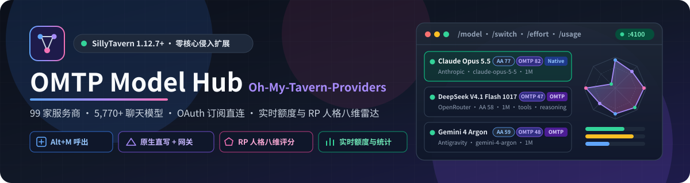
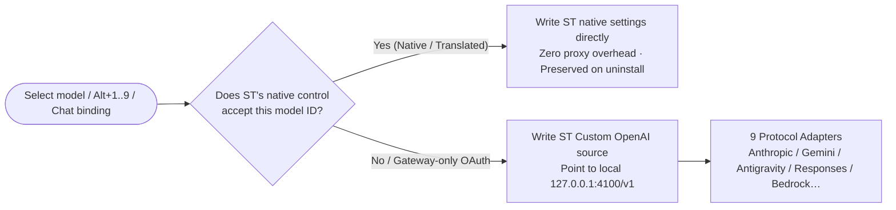

[English](./README.en.md) | [简体中文](./README.md)

<h1 align="center">OMTP Model Hub (Oh-My-Tavern-Providers)</h1>

<div align="center">

<h3>✨ A unified model hub for SillyTavern that brings 99 providers, 5,770+ chat models, OAuth sign-in, live quota tracking, and an 8-axis roleplay personality radar into one panel 🎭</h3>

<p>
  <a href="https://github.com/BHLuotianyi/Oh-My-Tavern-Providers/blob/main/LICENSE">
    
  </a>
  = 1.12.7" src="https://img.shields.io/badge/SillyTavern-%3E%3D1.12.7-10b981" />
  = 18" src="https://img.shields.io/badge/Node.js-%3E%3D18.0.0-68a063?logo=node.js&logoColor=white" />
  
</p>

<p>
  
</p>

<p>
This project is a part of <strong>SpaghettiTavern Saving Plan</strong>.<br/>
<em>“We shall meet again at the far shore of the stars”</em>
</p>

<p>
Built for SillyTavern 1.12.7 through 1.19.0+, focused on <strong>native-first routing, local gateway fallback, quantifiable roleplay personality, and local-only encrypted credentials</strong>.
</p>

🛠️ <strong>Active development</strong>

</div>

---

> [!NOTE]
> **Zero external runtime dependencies**: OMTP does **not** install, spawn, or invoke any `omp` binary or Python environment.
> [OMP (oh-my-pi)](https://github.com/can1357/oh-my-pi) serves strictly as the upstream model-catalog source and UX reference; both the SillyTavern client extension and the optional server plugin are standalone JavaScript / Node.js implementations.

> [!TIP]
> **Non-destructive & cleanly removable**: OMTP never modifies SillyTavern core files or mutates native `<select>` DOM options.
> Natively supported models write directly to SillyTavern's own settings; before entering gateway mode, OMTP snapshots your existing Custom OpenAI fields and restores them automatically when you switch back or disable the extension.

---

## Start Here

- 🚀 **Want to install and start chatting right away?** Jump to [30-Second Getting Started](#getting-started) and the [3-Minute Quick Tour](#quick-tour).
- 💡 **Curious what makes it better than the native dropdowns?** See [Why It Stands Out](#why-it-stands-out) and [Key Features](#key-features).
- 🔌 **Looking for the 24 plugin HTTP routes, 9 protocol adapters, and key encryption specs?** Read [docs/gateway.en.md](./docs/gateway.en.md).
- 🛠️ **Building an extension/script with `globalThis.OMTP` or rebuilding the catalog?** Read [docs/developer.en.md](./docs/developer.en.md).
- 🤝 **Want to contribute code or add a provider adapter?** Read [CONTRIBUTING.en.md](./CONTRIBUTING.en.md).

```text
OMTP Model Hub
├── Unified Hub Modal (Alt+M): 99 providers / 5,770 chat models / fuzzy search / quick slots @1..@9
├── Dual-Track Routing: zero-proxy native writes when ST supports the model, local 127.0.0.1:4100 gateway otherwise
├── Roleplay Personality Radar: 8-axis AA-PersonalityBench radar + OMTP roleplay-weighted score
├── Sign-in Center: OAuth PKCE / device code / Claude Pro·Max / Codex / Antigravity / API keys
└── Live Quotas & Accounting: 16 subscription quota bars, top-bar per-chat token/cost chip, /omtp stats dashboard
```

---

## About

In stock SillyTavern, switching models means opening the API drawer, changing the main API, changing the chat-completion source, hunting through hundreds of unsorted `<select>` options, and manually adjusting reasoning effort.

**OMTP Model Hub** replaces that workflow with a single searchable modal summoned anywhere via `Alt+M`:

- **Native-first, zero proxy overhead**: Whenever a model is supported by one of SillyTavern's 44 native adapters (OpenAI, Anthropic, Google, DeepSeek, OpenRouter, xAI, etc.), OMTP writes directly to SillyTavern's native settings. Generation requests go straight from SillyTavern to the provider.
- **Seamless local gateway fallback**: When a model isn't in SillyTavern's native dropdowns—or needs protocol translation (Google Antigravity / Gemini CLI OAuth, OpenAI Responses, AWS Bedrock Converse, Vertex AI)—OMTP points SillyTavern's Custom OpenAI source at its local loopback gateway (`127.0.0.1:4100/v1`).
- **Roleplay-aware model selection**: Every evaluated model displays both its [AA-PersonalityBench](https://artificialanalysis.ai/evaluations/aa-personalitybench) mean percentile and a dedicated **OMTP Roleplay Score** right on the row (e.g., `Claude Opus 5.5`: `AA 77 · OMTP 82`).

---

## Why It Stands Out

- **🎭 8-Axis Personality Radar Tuned for Roleplay & Creative Writing**
  High coding benchmark scores don't guarantee great roleplay—many models preach, flatter the user (high sycophancy), or repeat clichés (slop). OMTP bundles 8-axis personality data (Expressiveness, Organization, Informativeness, Transparency, Warmth, Conviction, Imagination, Slop) for 41 models and computes a roleplay-weighted score:
  $$\text{OMTP RP} = 26\%\text{Imagination} + 20\%\text{Warmth} + 18\%\text{Expressiveness} + 14\%\text{Non-Sycophancy} + 7\%\text{Transparency} + 6\%\text{Conviction} + 5\%\text{Informativeness} + 4\%\text{Organization} - 8\%\text{Slop}$$
  Click any model to inspect its 8-axis radar chart in the details pane, or check **Only models with scores** to filter the catalog down to evaluated models.

- **⚡ Automatic Dual-Track Routing**
  You never have to manually flip between native APIs and custom endpoints. Clicking **Use model** runs a deterministic check:



- **🔑 Unified Sign-in Center (Mirrors `omp /login`)**
  - **OAuth PKCE & Device-Code Flows**: Sign in to Claude Pro/Max, Google Antigravity, Gemini CLI, OpenAI Codex, and Kilo directly from the **Sign-in** tab. OMTP opens the authorize page in a new tab, listens on the loopback callback port, and provides a paste box when running on a remote server.
  - **Clear Credential States**: Stored keys render as masked dots and distinguish between `Signed in`, `Not signed in`, and `🔴 Key rejected · ****last4`.
  - **Live Model Probing**: Click `🔄` on any provider (including local Ollama / LM Studio / vLLM) to query its live `/models` endpoint and tag discovered models with a `live` badge.

- **📊 16 Subscription Quota Monitors + Per-Chat Token & Cost Ledger**
  - **Usage Tab (`/usage`)**: Reads real-time 5-hour / weekly quota windows, reset countdowns, and prepaid balances from Claude Pro/Max, ChatGPT Codex, Antigravity/Gemini CLI, Z.AI/Zhipu, Kimi Code, MiniMax Token Plan, xAI SuperGrok, DeepSeek, and 8 more providers.
  - **Top-Bar Token Chip**: Shows the active chat's running token count and estimated cost (`12.4k tok · $0.018`), preserving cached-input and reasoning/thoughts token breakdowns across Anthropic, Gemini, Bedrock, and Responses APIs.
  - **Local Stats Dashboard (`/omtp stats`)**: Spawns a loopback dashboard server (default port `3847`) with KPI cards, a 60-day bar chart, per-model breakdown, and a per-chat session selector.

---

## Getting Started

Requirements: **SillyTavern >= 1.12.7** and **Node.js >= 18.0.0**.

### Step 1: Install the Client Extension (Required, 30 seconds)

Clone this repository into SillyTavern's third-party extensions folder (**the directory name must be `omtp-model-hub`**):

```bash
cd SillyTavern/public/scripts/extensions/third-party/
git clone https://github.com/BHLuotianyi/Oh-My-Tavern-Providers omtp-model-hub
```

> If you only use providers that SillyTavern already supports natively, reload SillyTavern and you're done!

### Step 2: Install the Server Plugin (Recommended — unlocks all 99 providers, OAuth & usage stats)

1. Copy (or symlink) `server-plugin/` to SillyTavern's `plugins/omtp/` directory:
   ```bash
   cp -r SillyTavern/public/scripts/extensions/third-party/omtp-model-hub/server-plugin SillyTavern/plugins/omtp
   ```
2. Enable server plugins in `SillyTavern/config.yaml`:
   ```yaml
   enableServerPlugins: true
   ```
3. Restart the SillyTavern server and reload the page. A green **`🟢 Gateway: :4100`** pill in the hub header confirms the gateway is live.

---

## Quick Tour

1. **Open the Hub**: Press **`Alt+M`**, click the network icon in the top bar, or click the **OMTP Model Hub** button on SillyTavern's welcome prompt.
2. **Add Keys or Sign In**: Switch to the **Sign-in** tab, search for your provider (`Anthropic`, `DeepSeek`, `OpenRouter`, etc.), and paste an API key or start OAuth sign-in. (*Keys already saved in SillyTavern's native settings are detected and reused automatically!*)
3. **Pick a Model**: In the **All** tab, the left sidebar groups **33 first-party AI labs** above the divider and aggregators/cloud providers below. Click a model row and press **Use model** (or `Enter`).
4. **Pin to Quick Slots**: Click **Save to quick bar** in the details pane, then click slot `1–9`. Press **`Alt+1` .. `Alt+9`** anytime to switch models instantly.
5. **Bind to Chat or Character**: Click **Bind character** or **Bind chat** in the details pane so OMTP automatically switches to that model whenever you open that character or chat.

---

## Key Features

### 🧭 Four Route Badges

| Badge | Meaning | Needs Server Plugin? | After Uninstall |
|---|---|---|---|
| **Native** | Provider is natively supported by SillyTavern and the native control accepts the model ID | No | ✅ Preserved |
| **Translated** | Catalog provider mapped to a native SillyTavern adapter (e.g. `minimax-cn`) | No | ✅ Preserved |
| **OMTP** | Routed through the local `127.0.0.1:4100/v1` gateway via SillyTavern's Custom OpenAI source | **Yes** | Restores prior snapshot on disable |
| **Profile** | Connection Manager extension profile | No | ✅ Preserved |

### ⌨️ Slash Commands & Terminal-Style Quick Picker

| Command | Effect | Example |
|---|---|---|
| `/omtp` | Open the OMTP Model Hub modal | `/omtp` |
| `/model [selector]` | Switch model **and** save it as the default (no arg: open hub) | `/model anthropic/claude-opus-5-5:high` |
| `/switch [selector]` | Switch model **for this session only** (no arg: open compact keyboard picker) | `/switch @2` · `/switch gemini-4-argon` |
| `/effort [level]` | Cycle or set reasoning effort (`auto`, `min`, `low`, `medium`, `high`, `max`) | `/effort high` |
| `/usage` | Open the Usage & Quotas tab directly | `/usage` |
| `/omtp stats` | Start (or reuse) the local stats dashboard and open it in a new tab | `/omtp stats` |

### 🛠️ Power-User Controls

- **Per-Model Reasoning Memory**: Reasoning levels set via the details pane or `/effort` are remembered per model (`Claude Opus 5.5`, `DeepSeek V4.1 Flash 1017`, `Gemini 4 Argon`, etc.) and written to `openai_reasoning_effort` when active.
- **Extra Body JSON**: Attach a custom JSON object to any model entry to merge custom sampling or vendor parameters at generation time; routing keys (`model`, `messages`, `prompt`, `stream`) are protected.
- **Mainstream & Scored Filters**: Toggle **Show non-mainstream providers** (whitelists 52 mainstream providers), **Only models with scores**, and **Translated provider names** (in non-English UIs).
- **Local OMP Import**: Import a local `oh-my-pi` catalog overlay and optionally import stored API keys and OAuth sessions (`google-antigravity`, `google-gemini-cli`, `anthropic`) from `~/.omp/agent/agent.db`.

---

## Privacy & Security

- **Local AES-256-GCM KeyStore**: Provider API keys, OAuth tokens, and custom provider configs are encrypted with AES-256-GCM (`data/omtp/master.key`, mode `0600`) inside `data/omtp/providers.json`. Management endpoints only ever return the key source and last 4 characters.
- **No Shipped OAuth Secrets**: The repository contains zero OAuth client secrets. Supply your own via `OMTP_<PROVIDER>_CLIENT_ID` environment variables or `data/omtp/oauth-clients.json` (mode `0600`, git-ignored).
- **Zero Telemetry, Loopback Only**: The gateway binds strictly to `127.0.0.1` and connects directly to upstream provider endpoints.

---

## FAQ

<details>
<summary><b>Q1: Do I need Python or an existing OMP (oh-my-pi) installation?</b></summary>
<br/>
No. OMTP is a pure JavaScript / Node.js extension and plugin for SillyTavern with the 99-provider catalog and personality snapshot bundled out of the box.
</details>

<details>
<summary><b>Q2: Why is a model visible in search but disabled?</b></summary>
<br/>
The details pane shows the exact reason:
<ol>
  <li><b>Missing credentials</b>: Click <b>Open sign-in</b> in the details card to add an API key or complete OAuth sign-in.</li>
  <li><b>Server plugin not running</b>: Models badged <code>OMTP</code> require the server plugin (see Step 2 above).</li>
  <li><b>Proprietary client protocol</b>: Providers that only speak proprietary agent/IDE protocols (e.g., Cursor, Devin, GitHub Copilot) cannot be driven headlessly and are shown with an explanation.</li>
</ol>
</details>

<details>
<summary><b>Q3: Where did SillyTavern's native API selector go, and how do I restore it?</b></summary>
<br/>
OMTP hides <code>#main-API-selector-block</code> via a CSS class on <code>&lt;body&gt;</code> without removing any DOM nodes. Click <b>Show native API selector</b> in the API drawer or uncheck <b>Hide native API selector</b> in extension settings anytime.
</details>

<details>
<summary><b>Q4: Why are image, audio, and embedding models excluded?</b></summary>
<br/>
OMTP is dedicated to chat and roleplay text generation in SillyTavern; the catalog build pipeline keeps only <code>kind: 'chat'</code> models so thousands of embedding/TTS entries don't clutter search.
</details>

---

## Documentation

| Guide | Contents |
|---|---|
| 🔌 [**Gateway & Server Plugin Reference (docs/gateway.en.md)**](./docs/gateway.en.md) | Listener ports & auth, all 24 plugin HTTP routes, 9 protocol adapters, 16 quota endpoints, `data/omtp/` files |
| 🛠️ [**Developer API & Build Guide (docs/developer.en.md)**](./docs/developer.en.md) | `globalThis.OMTP` methods & events, selector grammar, catalog & personality build scripts, local mock server |
| 🧪 [**End-to-End Verification Checklist (tests/e2e/README.md)**](./tests/e2e/README.md) | Manual verification walkthrough for native routing, gateway streaming, bindings, and teardown rollback |
| 🤝 [**Contributing & Architecture Guide (CONTRIBUTING.en.md)**](./CONTRIBUTING.en.md) | Repository layout, standalone layer contracts, quality guardrails, style & PR workflow |
| 📚 [**OMP Model Selection Notes (model-selection-omp/)**](./model-selection-omp/README.md) | Upstream `oh-my-pi` selector architecture reference notes |

---

## Credits & License

<table>
<tr>
  <td><a href="https://github.com/can1357/oh-my-pi"><b>OMP (oh-my-pi)</b></a></td>
  <td>✨ The gateway, sign-in flows (<code>/login</code>), usage pages (<code>/usage</code>), and stats dashboard (<code>stats</code>) follow OMP's design; the bundled catalog is derived from OMP's MIT-licensed <code>models.json</code> (see <a href="./NOTICE">NOTICE</a>).</td>
</tr>
<tr>
  <td><a href="https://artificialanalysis.ai/evaluations/aa-personalitybench"><b>AA-PersonalityBench</b></a></td>
  <td>📊 8-axis model personality evaluation data by Artificial Analysis.</td>
</tr>
<tr>
  <td><a href="https://github.com/SillyTavern/SillyTavern"><b>SillyTavern</b></a></td>
  <td>🍺 The open-source frontend LLM tavern interface.</td>
</tr>
</table>

Released under the [**GNU General Public License v3.0 (GPL-3.0)**](./LICENSE), © 2026 [BHLuotianyi](https://github.com/BHLuotianyi).
