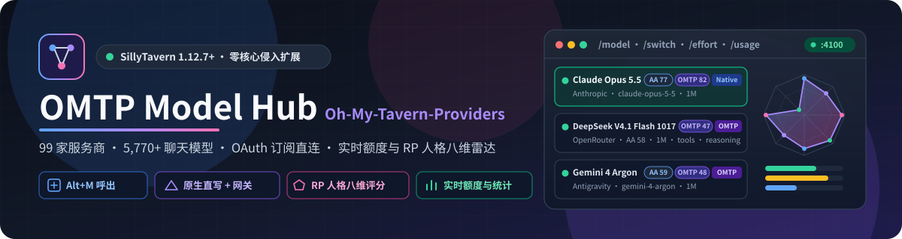

English | [简体中文](./README.md)

# OMTP Model Hub

[](./LICENSE)




OMTP Model Hub (Oh-My-Tavern-Providers) is a model picker for SillyTavern. It puts the chat models of many providers into one searchable panel and configures SillyTavern's connection when you pick one. Models SillyTavern cannot drive itself go through a bundled local gateway that translates the protocol.

The bundled catalog is generated from the model data of [oh-my-pi (OMP)](https://github.com/can1357/oh-my-pi): about 100 providers and more than 5,700 chat models. OMTP only uses that data; it never runs the OMP program and needs no Python.

## Features

- **Model panel**: search, favorites, recents, nine quick slots (`Alt+1` … `Alt+9`).
- **Two connection paths**: models SillyTavern supports natively are written straight into its own settings; everything else goes through the local gateway at `127.0.0.1:4100`, which speaks Anthropic, Gemini, Vertex AI, Bedrock, OpenAI Responses and more.
- **Sign-in**: API keys, OAuth authorization code (PKCE) and device code. Credentials are stored encrypted on your machine.
- **Usage**: quota windows of subscription providers, tokens and estimated cost of the current chat, a local statistics page.
- **Role-play reference**: AA-PersonalityBench personality scores and an OMTP score weighted for role-play.
- **Also**: per-chat and per-character model bindings, reasoning effort and extra request body remembered per model, management of SillyTavern connection profiles.

## Requirements

- SillyTavern 1.12.7 or later
- Node.js 18 or later (server plugin or TauriTavern companion only)

## Installation

OMTP has two parts:

| Part | Location | Required |
|---|---|---|
| Client extension | `SillyTavern/public/scripts/extensions/third-party/omtp-model-hub/` | Yes |
| Server plugin | `SillyTavern/plugins/omtp/` | Optional. The gateway, OAuth sign-in, quotas and statistics depend on it |

### 1. Client extension

```bash
cd SillyTavern/public/scripts/extensions/third-party
git clone https://github.com/BHLuotianyi/Oh-My-Tavern-Providers omtp-model-hub
```

Without Git: choose **Code → Download ZIP** on GitHub, extract it, rename the folder to `omtp-model-hub` and move it into the `third-party` directory above.

Reload SillyTavern and the panel works; gateway models, sign-in and usage stay unavailable until the plugin is installed.

### 2. Server plugin

1. Copy the extension's `server-plugin` directory to `SillyTavern/plugins/omtp`:

   ```bash
   cp -r SillyTavern/public/scripts/extensions/third-party/omtp-model-hub/server-plugin SillyTavern/plugins/omtp
   ```

2. Set this in `SillyTavern/config.yaml`:

   ```yaml
   enableServerPlugins: true
   ```

3. Restart SillyTavern. When the OMTP panel shows a gateway port (such as `:4100`), the plugin is running.

If you redistribute the `server-plugin` directory on its own, include [`NOTICE`](./NOTICE) from the repository root: the bundled catalog is derived from OMP's `models.json` (MIT).

### TauriTavern

[TauriTavern](https://st-doc.pages.dev/tauritavern/) loads the client extension: install it from its extension manager with the Git URL `https://github.com/BHLuotianyi/Oh-My-Tavern-Providers`. With the extension alone, models SillyTavern supports natively (**Native** badge) work.

TauriTavern's backend is written in Rust and cannot run SillyTavern server plugins. Gateway models, sign-in, usage and statistics come from the **companion** instead: the same code as the server plugin, run on its own with Node:

1. On a computer with Node.js 18+, get this repository (`git clone`, or use the extension folder under `extensions/` in TauriTavern's data directory) and run:

   ```bash
   node server-plugin/standalone.mjs
   ```

   It prints an address (`http://127.0.0.1:4099` by default) and a token. Data is kept in `~/.omtp-companion/omtp/`; add `--data SillyTavern/data` to share keys with an existing SillyTavern. `--help` lists all options.
2. In TauriTavern's **Extensions** settings, open OMTP Model Hub, enter the address and token under **Companion (TauriTavern)** and click **Connect**.
3. The first time a gateway model is used, TauriTavern asks whether to allow connections to `http://127.0.0.1:4100/v1`; allow it.

Notes:

- TauriTavern on a phone can use a companion on a computer in the same LAN: start it with `--host 0.0.0.0` and enter the computer's LAN address on the phone. The companion and the gateway only accept requests that carry their token; do this on trusted networks only. The statistics page (`/omtp stats`) listens on the computer only and does not open on the phone. On Android the companion can also run under Node in Termux.
- OAuth callbacks go to the computer that runs the companion. When the companion runs on another device, paste the full URL from the address bar after authorizing into the panel instead.
- TauriTavern keeps only the Chat Completion API; text completion, NovelAI and AI Horde models show as unavailable.
- When a TauriTavern Custom connection uses another wire format (such as Claude Messages), OMTP keeps that format when it restores the connection.

### Updating

```bash
cd SillyTavern/public/scripts/extensions/third-party/omtp-model-hub
git pull
```

With the server plugin installed, copy it again and restart SillyTavern; otherwise the old server code keeps running:

```bash
rm -rf SillyTavern/plugins/omtp
cp -r SillyTavern/public/scripts/extensions/third-party/omtp-model-hub/server-plugin SillyTavern/plugins/omtp
```

Saved keys and sign-ins live in `SillyTavern/data/omtp/`, separate from the extension, so updates keep them. Do not delete that directory.

For daily builds, clone the `nightly` branch instead: `git clone -b nightly …`. The channels are described in [docs/releasing.en.md](./docs/releasing.en.md).

### Uninstalling

1. **Disable** OMTP in SillyTavern's extension manager first. Disabling restores the Custom OpenAI connection to what it was before the gateway was used.
2. Delete `third-party/omtp-model-hub/` and `plugins/omtp/`.
3. Delete `data/omtp/` if you no longer need the saved keys.

If the files are deleted without disabling first, OMTP never gets the chance to restore anything; check the Custom OpenAI URL in SillyTavern by hand.

## Getting started

1. Press `Alt+M`, or click the OMTP button in the top bar, to open the panel.
2. On the **Sign-in** tab, enter a provider's API key or sign in with OAuth. Keys already saved in SillyTavern are used as they are.
3. Back on **All**, search for a model, select it and click **Use model** (or press Enter).
4. In the model details click **Save to quick bar**, then a slot; switch with `Alt+1` … `Alt+9` from then on.
5. Optionally click **Bind chat** or **Bind character** so that opening that chat or character switches to the model automatically.

The [user guide](./docs/user-guide.en.md) covers everything else.

## Documentation

| Document | Contents |
|---|---|
| [User guide](./docs/user-guide.en.md) | Panel, sign-in, routing, bindings, usage, slash commands, settings, FAQ |
| [Server plugin reference](./docs/gateway.en.md) | Gateway, management API, protocol adapters, credentials and OAuth, data files, proxy, security |
| [Developer API](./docs/developer.en.md) | `globalThis.OMTP`, events, selector grammar, calling the plugin API from scripts |
| [Contributing](./CONTRIBUTING.en.md) | Code layout, invariants, catalog maintenance, pull requests |
| [Testing](./docs/testing.en.md) | Unit tests, local mock provider, manual end-to-end checks |
| [Versions and releases](./docs/releasing.en.md) | Version numbers, Main / Nightly / Release channels, release steps |
| [OMP model selection notes](./docs/reference/omp-model-selection/README.md) | Analysis of OMP's model selection design (Chinese), kept as design reference |

## Privacy

- API keys and OAuth tokens saved through OMTP are encrypted with AES-256-GCM in `data/omtp/providers.json`; the master key `data/omtp/master.key` has mode `0600`.
- The gateway listens on `127.0.0.1` only and requires a token by default. Upstream requests go straight from your machine to the provider.
- OMTP collects no telemetry and uses no third-party relay.

See the [server plugin reference](./docs/gateway.en.md#security-boundaries) for the full security model.

## Credits and license

- [oh-my-pi (OMP)](https://github.com/can1357/oh-my-pi): source of the model catalog (MIT, see [NOTICE](./NOTICE)); design reference for sign-in, usage and statistics.
- [AA-PersonalityBench](https://artificialanalysis.ai/evaluations/aa-personalitybench) by Artificial Analysis: personality scores.
- [SillyTavern](https://github.com/SillyTavern/SillyTavern): the host application.

Released under [GPL-3.0](./LICENSE). © 2026 [BHLuotianyi](https://github.com/BHLuotianyi)
