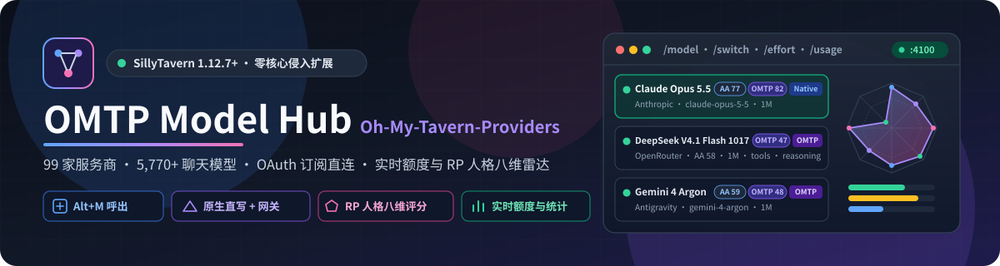

[English](./README.en.md) | 简体中文

# OMTP Model Hub

[](./LICENSE)




OMTP Model Hub（Oh-My-Tavern-Providers）是 SillyTavern 的模型选择扩展。它把各家服务商的聊天模型集中到一个可搜索的面板里，选中后自动配置 SillyTavern 的连接；SillyTavern 本身不支持的模型，由随附的本地网关转换协议后转发。

内置目录由 [oh-my-pi（OMP）](https://github.com/can1357/oh-my-pi) 的模型数据生成，目前约 100 家服务商、5,700 多个聊天模型。OMTP 只使用这份数据，不运行 OMP 程序，也不需要 Python。

## 功能

- **模型面板**：搜索、收藏、最近使用、9 个快捷槽位（`Alt+1` … `Alt+9`）。
- **两种连接方式**：SillyTavern 原生支持的模型直接写入原生设置；其余模型经本机网关 `127.0.0.1:4100` 转发，支持 Anthropic、Gemini、Vertex AI、Bedrock、OpenAI Responses 等协议。
- **登录**：API 密钥、OAuth 授权码（PKCE）、设备码。凭据加密保存在本机。
- **用量**：订阅服务商的额度窗口，当前对话的 token 数与估算费用，本地统计页面。
- **角色扮演参考**：显示 AA-PersonalityBench 的人格维度评分，以及按角色扮演加权的 OMTP 分数。
- **其他**：按聊天或角色绑定模型、按模型记住推理强度和附加请求体、管理 SillyTavern 的连接档案。

## 环境要求

- SillyTavern 1.12.7 或更高版本
- Node.js 18 或更高版本（仅服务端插件需要，即运行 SillyTavern 的 Node）

## 安装

OMTP 由两部分组成：

| 部分 | 位置 | 是否必需 |
|---|---|---|
| 客户端扩展 | `SillyTavern/public/scripts/extensions/third-party/omtp-model-hub/` | 必需 |
| 服务端插件 | `SillyTavern/plugins/omtp/` | 可选。网关、OAuth 登录、额度与统计都依赖它 |

### 1. 客户端扩展

```bash
cd SillyTavern/public/scripts/extensions/third-party
git clone https://github.com/BHLuotianyi/Oh-My-Tavern-Providers omtp-model-hub
```

不使用 Git 时：在 GitHub 页面选择 **Code → Download ZIP**，解压后把文件夹改名为 `omtp-model-hub`，放到上面的 `third-party` 目录下。

刷新 SillyTavern 页面后即可使用，只是网关模型、登录与用量功能不可用。

### 2. 服务端插件

1. 把扩展里的 `server-plugin` 目录复制为 `SillyTavern/plugins/omtp`：

   ```bash
   cp -r SillyTavern/public/scripts/extensions/third-party/omtp-model-hub/server-plugin SillyTavern/plugins/omtp
   ```

2. 在 `SillyTavern/config.yaml` 中设置：

   ```yaml
   enableServerPlugins: true
   ```

3. 重启 SillyTavern。打开 OMTP 面板，网关状态显示端口（如 `:4100`）即表示插件已运行。

单独分发 `server-plugin` 目录时，请附上仓库根目录的 [`NOTICE`](./NOTICE)：内置目录衍生自 OMP 的 `models.json`（MIT 许可）。

### 更新

```bash
cd SillyTavern/public/scripts/extensions/third-party/omtp-model-hub
git pull
```

装了服务端插件的话，还要重新复制插件目录并重启 SillyTavern，否则后台仍运行旧代码：

```bash
rm -rf SillyTavern/plugins/omtp
cp -r SillyTavern/public/scripts/extensions/third-party/omtp-model-hub/server-plugin SillyTavern/plugins/omtp
```

已保存的密钥和登录状态在 `SillyTavern/data/omtp/`，与扩展目录分开，更新不会影响它们。不要删除这个目录。

想使用每日构建，克隆时改用 `nightly` 分支：`git clone -b nightly …`。版本通道的说明见 [docs/releasing.md](./docs/releasing.md)。

### 卸载

1. 在 SillyTavern 的扩展管理中**先停用** OMTP。停用时 OMTP 会把 Custom OpenAI 连接恢复为使用网关之前的设置。
2. 删除 `third-party/omtp-model-hub/` 和 `plugins/omtp/`。
3. 如不再需要已保存的密钥，删除 `data/omtp/`。

如果没有停用就直接删除了扩展文件，OMTP 没有机会恢复设置，需要在 SillyTavern 中手动检查 Custom OpenAI 的地址。

## 快速上手

1. 按 `Alt+M`，或点击顶栏的 OMTP 按钮，打开模型面板。
2. 在 **登录** 标签页填写服务商的 API 密钥，或点击登录完成 OAuth。已在 SillyTavern 中保存的密钥会被直接使用。
3. 回到 **全部** 标签页，搜索并选中模型，点击 **使用模型** 或按回车。
4. 在模型详情中点击 **保存到快捷栏**，再点击一个槽位；之后用 `Alt+1` … `Alt+9` 切换。
5. 需要的话，点击 **绑定当前聊天** 或 **绑定角色**，打开该聊天或角色时会自动切换到这个模型。

完整说明见 [使用指南](./docs/user-guide.md)。

## 文档

| 文档 | 内容 |
|---|---|
| [使用指南](./docs/user-guide.md) | 面板、登录、路由方式、绑定、用量、斜杠命令、设置项、常见问题 |
| [服务端插件参考](./docs/gateway.md) | 网关、管理接口、协议适配器、凭据与 OAuth、数据文件、代理、安全边界 |
| [开发者 API](./docs/developer.md) | `globalThis.OMTP`、事件、选择器语法、从脚本调用插件接口 |
| [贡献指南](./CONTRIBUTING.md) | 代码结构、约束、目录数据维护、提交流程 |
| [测试](./docs/testing.md) | 单元测试、本地模拟服务、手工端到端检查 |
| [版本与发布](./docs/releasing.md) | 版本号规则、Main / Nightly / Release 通道、发布步骤 |
| [OMP 模型选择笔记](./docs/reference/omp-model-selection/README.md) | 上游 OMP 模型选择体系的分析，供设计参考 |

## 隐私

- 通过 OMTP 保存的 API 密钥与 OAuth 令牌使用 AES-256-GCM 加密，保存在 `data/omtp/providers.json`；主密钥 `data/omtp/master.key` 权限为 `0600`。
- 网关只监听 `127.0.0.1`，默认要求令牌。上游请求从你的机器直接发往服务商。
- OMTP 不收集遥测，也不经过第三方服务器。

安全边界的细节见 [服务端插件参考](./docs/gateway.md#安全边界)。

## 致谢与许可

- [oh-my-pi（OMP）](https://github.com/can1357/oh-my-pi)：模型目录数据来源（MIT，见 [NOTICE](./NOTICE)）；登录、用量与统计页面的设计参考。
- [AA-PersonalityBench](https://artificialanalysis.ai/evaluations/aa-personalitybench)（Artificial Analysis）：人格评分数据。
- [SillyTavern](https://github.com/SillyTavern/SillyTavern)：宿主程序。

本项目以 [GPL-3.0](./LICENSE) 许可发布。© 2026 [BHLuotianyi](https://github.com/BHLuotianyi)
