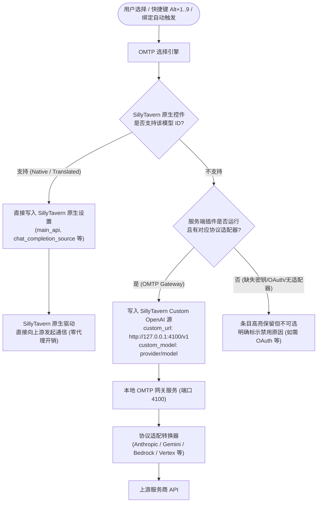

# OMTP Model Hub (Oh-My-Tavern-Providers)

SillyTavern 1.12.7+ 的统一模型中枢与协议路由扩展。将 SillyTavern 原生支持的 44 类接口、OMP 目录中 79 家服务商与 5,700+ 聊天模型，以及可选的本地协议转换网关，整合进一个支持即时模糊搜索、快速槽位切换与上下文绑定的统一抽屉面板。

[English Documentation](README.en.md) · [设计与移植参考](model-selection-omp/) · [E2E 测试清单](tests/e2e/README.md)

---

## 目录

- [项目定位与核心优势](#项目定位与核心优势)
- [双轨路由架构](#双轨路由架构)
- [快速安装](#快速安装)
  - [模式 A：客户端扩展（核心，推荐）](#模式-a客户端扩展核心推荐)
  - [模式 B：服务端网关插件（可选高级扩展）](#模式-b服务端网关插件可选高级扩展)
- [核心功能与交互指南](#核心功能与交互指南)
  - [呼出面板与快捷键](#呼出面板与快捷键)
  - [即时搜索与智能排序](#即时搜索与智能排序)
  - [快速槽位 (Alt+1..9)](#快速槽位-alt19)
  - [聊天与角色模型绑定](#聊天与角色模型绑定)
  - [推理强度控制 (Reasoning Effort)](#推理强度控制-reasoning-effort)
  - [自定义附加请求体 (Extra Body JSON)](#自定义附加请求体-extra-body-json)
  - [原生选择器无损隐藏与安全恢复](#原生选择器无损隐藏与安全恢复)
- [服务端插件与本地网关深度指南](#服务端插件与本地网关深度指南)
  - [网关端点与运行时配置](#网关端点与运行时配置)
  - [协议适配器支持矩阵](#协议适配器支持矩阵)
  - [加密密钥库与三级解析机制](#加密密钥库与三级解析机制)
  - [自定义服务商添加与连通性测试](#自定义服务商添加与连通性测试)
- [模型目录体系与离线构建](#模型目录体系与离线构建)
- [开发者 API 与选择器语法](#开发者-api-与选择器语法)
- [测试与本地调试](#测试与本地调试)
- [常见问题与已知限制](#常见问题与已知限制)
- [许可证与致谢](#许可证与致谢)

---

## 项目定位与核心优势

在默认的 SillyTavern 中，切换不同的服务商与模型需要频繁展开 API 抽屉、手动重新选择服务商下拉框、重新拉取模型列表并重新选择。

**OMTP Model Hub** 重塑了这一交互体验：
- **全生态模型统一索引**：聚合 79 家主流与垂直服务商、5,710 个聊天模型，统一搜索与分类视图。
- **双轨无缝路由**：优先走 SillyTavern 原生配置直写通道（零损耗、零代理开销）；遇到原生不支持的专有协议时，平滑转入本地网关做适配。
- **无缝沉浸操作**：全局 `Alt+M` 随时呼出，支持 9 组快速槽位一键盲切，彻底告别打断对话的菜单翻找。
- **智能场景绑定**：对话级绑定（随聊天存档迁移）与角色级绑定协同工作，进入聊天自动切至对应最优模型。
- **零破坏非侵入式**：不改写 SillyTavern 任何核心源码，不修改原生 `<select>` 选项列表。所有原生 API、密钥配置、Connection Profile 均原样保留。
- **纯粹自主运行**：OMTP 不安装、不启动外部 OMP 二进制进程，所有逻辑基于纯 JavaScript/Node.js 实现。

---

## 双轨路由架构

OMTP 采用**“原生直写优先，本地网关垫底”**的双轨路由策略：



### 路由徽章与执行机制

| 面板徽章 | 来源说明 | 底层路由动作 | 依赖服务端插件 | 扩展卸载/停用后表现 |
|---|---|---|---|---|
| **原生 (Native)** | SillyTavern 自身原生支持的厂商，且当前下拉控件中存在该模型 | 直接写入 ST 原生配置（如 `openai_model`、`claude_model` 等） | 否 | **永久保留**，直接使用 ST 原生通道 |
| **转换 (Translated)** | OMP 目录中可映射至 ST 44 类原生适配器的厂商，且控件接受该模型 | 转换为对应原生配置项并直接写入 | 否 | **永久保留**，直接使用 ST 原生通道 |
| **OMTP (Gateway)** | 目录中原生控件未包含的模型（或需特定协议转换） | 写入 Custom OpenAI 接口，定向至本地网关 `http://127.0.0.1:4100/v1` | **是** | 依赖网关；停用扩展后自动回滚原状态 |
| **配置档案 (Profile)** | 来自 Connection Manager 扩展的连接档案 | 调用该扩展的 Profile 切换逻辑 | 否 | **永久保留** |

---

## 快速安装

运行环境要求：**SillyTavern >= 1.12.7**，**Node.js >= 18.0.0**。完整兼容 SillyTavern 1.12.7 至 1.19.0+ 全系列版本。

### 模式 A：客户端扩展（核心，推荐）

适合使用 SillyTavern 原生所支持的模型、希望获得统一搜索、快速槽位、聊天绑定的用户。无需安装额外后台服务。

1. 进入 SillyTavern 第三方扩展目录：
   ```bash
   cd SillyTavern/public/scripts/extensions/third-party/
   ```
2. 克隆本仓库（**目录名必须保持为 `omtp-model-hub`**）：
   ```bash
   git clone https://github.com/winster42/Oh-My-Tavern-Providers omtp-model-hub
   ```
3. 刷新或重启 SillyTavern，在扩展面板中启用 **OMTP Model Hub**。

### 模式 B：服务端网关插件（可选高级扩展）

当需要使用 SillyTavern 原生未收录的服务商、或者需要协议转换（如将 OpenAI 接口转换为 Anthropic Messages、Google Vertex、AWS Bedrock Converse 等）时使用。

1. 完成模式 A 的安装。
2. 将本仓库的 `server-plugin/` 目录复制或软链接至 SillyTavern 插件目录：
   ```bash
   cp -r omtp-model-hub/server-plugin SillyTavern/plugins/omtp
   ```
3. 检查并开启 SillyTavern 根目录下的 `config.yaml`：
   ```yaml
   enableServerPlugins: true
   ```
4. 重启 SillyTavern 服务端。
5. 刷新 SillyTavern 页面，点击顶栏的 OMTP 图标（或按 `Alt+M`）呼出面板。

---

## 核心功能与交互指南

### 呼出面板与快捷键

- **全局热键**：按键盘 `Alt+M`（可在扩展设置中自定义热键）。
- **顶栏入口**：点击顶栏新增的网络图表图标（鼠标悬停可查看当前模型与服务商）。
- **API 抽屉入口**：展开 SillyTavern 原生 API 抽屉，点击顶部的“切换模型”按钮。

### Slash 命令

对齐 `omp` 的四条命令：

| 命令 | 作用 |
|---|---|
| `/omtp` | 呼出模型中心面板 |
| `/model [选择器]` | 不带参数：打开面板；带参数：切换模型并记为默认 |
| `/switch [选择器]` | 不带参数：打开快速选择器；带参数：仅本次会话切换 |
| `/effort [强度]` | 不带参数：循环切换推理强度；带参数：直接设定 |
| `/omtp stats` | 启动（或复用）本地统计面板，在新标签页打开 |

选择器支持 `provider/model`、模糊模型名、快速槽位 `@1`-`@9`、`@fav`，以及 `:level` 后缀（如 `opus:high`）。

`/switch` 对应 omp 的 `setModelTemporary`：模型立即生效，但不覆盖已保存的默认选择——下次 `/model` 或重载后回到默认。选择器为终端风格：`↑↓` 循环移动，`PgUp`/`PgDn`/`Home`/`End` 跳转，`Enter` 应用，`Esc` 先清空输入、再按一次关闭。

`/effort` 按 `auto → min → low → medium → high → max` 循环，且只在该模型声明的档位内循环；未知值会报错并列出可选档位，不支持推理的模型会明确提示。

### 欢迎页入口

Tavern 欢迎页底部原来那个「API 连接」按钮（`welcomePrompt.html` 的第一颗）被替换成「OMTP 模型中心」，点击直接打开本扩展；图标与文案随语言切换（`omtp_open_hub`）。欢迎页每次重新渲染都会自动重新打补丁（MutationObserver），禁用/卸载扩展时会还原原始按钮。原生 API 连接入口仍可通过左侧抽屉的插头图标进入。

### OAuth 客户端凭据

仓库里**不含任何** OAuth 客户端 id / secret：内置目录只写环境变量名（如 `OMTP_GOOGLE_ANTIGRAVITY_CLIENT_ID`），实际值在运行时从本地读取，按优先级：

1. 环境变量（名字见目录条目里的 `env` 数组，可用 `OMTP_<PROVIDER>_CLIENT_ID` / `OMTP_<PROVIDER>_CLIENT_SECRET`）；
2. `data/omtp/oauth-clients.json`：

```json
{
  "google-antigravity": { "clientId": "…", "clientSecret": "…" },
  "openai-codex": { "clientId": "…" }
}
```

文件权限建议 `600`，且已在 `.gitignore` 中排除。缺值时该服务商的 OAuth 登录/刷新会给出明确报错，其余（API Key 登录、网关转发、模型列表）不受影响。这些 client id 本身是公开的应用标识（installed app 的 client secret 按 RFC 8252 §8.1 也不算机密），但为了避免密钥扫描与误用，一律不入库。

### 登录（对应 omp 的 /login）

「登录」标签页即 OMTP 的 `/login`：每个服务商一行，显示状态（`已登录 · 账号` / `未登录` / `密钥被拒绝 · ****末四位`）与唯一主操作。状态里始终带上凭据指纹，已保存的密钥在输入框里以圆点显示，所以「没有密钥」与「已保存的密钥被拒绝」不会再混淆。该列表按登录方式（OAuth → 设备码 → 专属钩子 → API Key）再按名称排序，顶部搜索框在该标签页里直接过滤服务商名单（匹配名称、ID 与登录方式），无匹配时给出提示。

- OMP 策略为 `oauth-code` 的服务商走真实 PKCE 流程：OMTP 在策略指定的回调端口起一个本地监听，给出授权链接；浏览器无法访问本机时可粘贴回调 URL 或授权码完成。
- `device-code` 服务商直接给出验证链接与用户码，并在后台轮询直到授权完成。
- `api-key` 服务商提供密钥输入框与控制台链接。
- 点击「登录」会立即在新标签页打开授权页（授权链接要等服务端返回，所以先同步开一个空白页再导航，避免被弹窗拦截）；被拦截时保留可点击的链接。
- 回调成功/失败页按客户端语言显示（启动登录时把 `navigator.language` 传给服务端，缺省回退 `Accept-Language`）。
- 需要专属代码的策略由 `server-plugin/lib/custom-logins/` 里的钩子实现：目前支持 `openai-codex-device`（Codex 无头设备码，凭据存到 `openai-codex`）、`kilo`（Kilo 设备码），以及 `kimi-fingerprint`（Kimi CLI 指纹请求头）。其余钩子（Cursor、GitHub Copilot、Devin、Cloudflare、Snowflake 等）仍会提示并指向 OMP 导入。
- 已保存的密钥在输入框里显示为圆点（不显示明文，也不会被当作新密钥提交）：直接保存会提示「这是已保存的密钥」，修改后才可替换。
- 令牌以结构化凭据存入加密密钥库，按服务商的 token 端点自动刷新，由网关使用。

### Token 统计与预估费用

聊天顶部栏（图标行最右侧）会常驻一个小徽标 `95 token · $0.000146`，显示**当前对话**的累计 token 与预估费用，悬停看输入/缓存/输出/推理明细，点击直接打开用量页。每次生成结束（`generation_ended`）后 0.6 秒刷新，切换聊天时归零。只有走 OMTP 网关的请求会被统计。

网关会把每次补全的用量记到 `data/omtp/usage-stats.json`（参考 OMP 的 run collector）：非缓存输入、缓存读取、缓存写入、输出、推理输出、请求数与预估费用。用量页顶部显示：

- **本次会话**（切换聊天时归零）：请求数 / 输入 / 缓存 / 输出 / 推理 / 预估费用。
- **累计**：安装以来的同样指标。
- **按模型**：最近会话（无则累计）里请求数最多的 8 个模型，含各自的分项 token 与费用。

适配器会保留上游的缓存与推理明细：Gemini 的 `cachedContentTokenCount` / `thoughtsTokenCount`、Anthropic 的 `cache_read_input_tokens` / `cache_creation_input_tokens`、Bedrock 的 `cacheReadInputTokens` / `cacheWriteInputTokens`、Responses API 的 `input_tokens_details.cached_tokens`，统一映射为 OpenAI 的 `prompt_tokens_details.cached_tokens` / `cache_write_tokens` 与 `completion_tokens_details.reasoning_tokens`。所以「缓存」一栏为 0 时，是上游确实没报缓存命中（Gemini 隐式缓存需要 ≥1024 token 的公共前缀并被服务商统计），而不是我们漏算。

### 本地统计面板（对应 `omp stats`）

`/omtp stats` 让服务端起一个只监听 `127.0.0.1` 的 HTTP 服务（默认端口 `3847`，被占用时自动换临时端口），并在新标签页打开该页面——和 `omp stats` 一样是「本地服务器 + 网页」。页面每 5 秒自动刷新，包含：

- 顶部指标卡：请求数 / 非缓存输入 / 缓存命中（含命中率）/ 输出 / 推理（有数据时才显示）/ 预估费用；范围可在「当前对话 / 最近 24 小时 / 安装以来 / 累计」之间切换。
- 会话选择器：范围选「当前对话」时出现下拉框，列出所有记录过的对话（按费用排序，带请求数与费用），选中即切换该对话的指标卡与按模型表；直接点下方「按对话」表里的任意一行也会跳转。
- 每日用量柱状图（最近 60 天，悬停看当天 token / 费用 / 请求数）。
- 按模型表（请求 / 输入 / 缓存 / 输出 / 推理 / 费用）。
- 按对话表（每个 chat 的用量与最后使用时间，当前对话高亮并带 ● 标记）。

页面文案跟随 SillyTavern 的界面语言（`/omtp stats` 会把 `document.documentElement.lang` 作为 `?lang=` 传过去，缺省回落到浏览器语言），中英各一套内置词典；标签页图标是页面自带的 SVG data URI（蓝底柱状图），不借用任何外部 favicon。

实现要点：`server-plugin/lib/stats-server.mjs` 的 `ensureStatsServer()` 负责起服务并复用已有实例（通过 `x-omtp-stats-dashboard` 响应头识别），空闲 30 分钟自动关闭，SillyTavern 卸载插件（`exit()`）时也会关闭；数据来自 `UsageStats.snapshot()` 与新增的 `UsageStats.dashboard()`。

费用按目录里每个模型的 `cost`（每百万 token 的 input / output / cacheRead / cacheWrite，来自 OMP 的 `models.json`）估算，缓存读取单独按缓存单价计。流式与非流式响应都会被统计：网关注入一个旁路 tap，从 SSE 的 `data:` 帧或 JSON 响应里取最后一个 `usage`。

接口：`GET /api/plugins/omtp/stats`（`?since=<ISO>` 只统计该时刻之后，用于「本次会话」）。

### 用量（对应 omp 的 `usage`）

「用量」标签页汇总各服务商的额度消耗，数据来自各家自己的用量接口（`server-plugin/lib/usage.mjs`，逻辑参考 OMP 的 `packages/ai/src/usage/*`）。`/usage` 命令直接打开这个页面（已在面板中打开时会切换标签页）。

| 服务商 | 接口 | 数据 |
|---|---|---|
| Google Antigravity / Gemini CLI | `POST /v1internal:retrieveUserQuotaSummary` | 按模型族的周 / 5 小时窗口 |
| OpenAI Codex / ChatGPT 订阅 | `GET chatgpt.com/backend-api/wham/usage` | Primary/Secondary 窗口 + 套餐 |
| Anthropic Claude Pro/Max | `GET api.anthropic.com/api/oauth/usage` | 5 小时 / 7 天 / 按模型 + 额外用量余额 |
| Z.AI / 智谱编码套餐 | `GET api.z.ai/api/monitor/usage/quota/limit` | Token / 时间 / 额度窗口（token 不加 Bearer 前缀） |
| Kimi Code | `GET api.kimi.com/coding/v1/usages` | 各个窗口的已用/剩余 |
| MiniMax Token Plan（国际/国内） | `GET {api.minimax.io｜api.minimaxi.com}/v1/token_plan/remains` | 每个模型的 5 小时 / 周窗口 |
| xAI（SuperGrok） | `GET cli-chat-proxy.grok.com/v1/billing?format=credits` | 周额度 / 月度额度 / 按需用量 |
| GitHub Copilot | `GET api.github.com/copilot_internal/user` | Premium / Chat / Completions 配额 + 重置日 |
| OpenCode Go | `GET opencode.ai/zen/go/v1/usage` | 5 小时 / 周 / 月窗口（需 Go 订阅） |
| Cursor | `GET api2.cursor.sh/auth/usage` | 账单周期内的请求配额（API-key 账户） |
| Command Code | `GET api.commandcode.ai/alpha/billing/credits`（+`/alpha/whoami`） | 5 小时 / 周窗口 + 剩余额度 |
| ClinePass | `GET api.cline.bot/api/v1/users/me/plan/usage-limits` | 5 小时 / 周 / 月窗口 |
| Synthetic | `GET api.synthetic.new/v2/quotas` | 滚动 5 小时 / 周窗口 |
| Umans | `GET api.code.umans.ai/v1/usage` | 请求窗口 / 突发上限 |
| Charm Hyper | `GET hyper.charm.land/v1/credits` | 余额 |
| DeepSeek | `GET api.deepseek.com/user/balance` | 账户余额（按币种） |

- 每条额度显示名称、已用百分比、进度条与重置倒计时；70% 起变黄、90% 起变红。
- 读数缓存 60 秒，页脚「刷新」按钮强制重新拉取。
- 未配置凭据、或没有额度接口的服务商不出现在该页（与 omp 一致），也不会编造数据；凭据被拒时显示「凭据被拒绝（HTTP 401）」。
- 未实现的服务商：OpenCode Zen（无用量接口）、GitHub Copilot 的 API-key 计费路径、Devin（Connect/protobuf 协议）、Ollama（无独立额度接口）。

### AA-PersonalityBench 分数与雷达图

模型卡与详情面板会显示 Artificial Analysis 的 [AA-PersonalityBench](https://artificialanalysis.ai/evaluations/aa-personalitybench) 数据：

- 列表里模型名旁有两个徽标：`AA 59` 是 8 个维度百分位的平均值；`OMTP 62` 是面向角色扮演／创作的加权分（无雷达图）。
- `OMTP` 分权重固定：想象力 26% · 亲和力 20% · 表现力 18% · 不谄媚 14% · 透明度 7% · 坚定度 6% · 信息量 5% · 条理性 4%，再按 slop 扣 8%（`src/personality.js#RP_WEIGHTS`）。透明度整体权重低，但其中「不谄媚」单独按 14% 计权。
- 详情面板显示 8 维雷达图（表现力 / 条理性 / 信息量 / 透明度 / 亲和力 / 坚定度 / 想象力 / 冗余度）与逐项分数条，标题旁的 `↗` 直接跳到 AA-PersonalityBench 页面。
- 数据来自公开评测页的内嵌数据（41 个模型），快照存于 `catalog/personality.json`；AA 的免费 API 需要账号且禁止在客户端放置密钥，所以不在运行时调用。
- AA 只为部分模型公布 8 个维度的百分位；其余模型按 AA 文档的方法（各维度特征的 z 分数取均值，透明度中「谄媚」取反，再在全部 41 个模型里排百分位）换算，并在面板中标注「指数由 AA 的细分特征 z 分数换算」。换算结果与 AA 公布的 88 个值最大偏差 0.95。

刷新快照（离线缓存位于 `.cache/`）：

```bash
npm run personality          # 重新抓取并写入 catalog/personality.json
npm run personality:verify   # 只校验换算结果与 AA 公布值的一致性
```

> 后续可以把这个快照交给 GitHub Actions / Cloudflare Worker 定期生成，作为 OMTP 的官方数据源。

### 列表与筛选

- 快速栏：在模型卡点「保存到快捷栏」后，左键点击 1–9 中任一栏位即填入/覆盖（其他栏位里同一个模型会被自动移除），右键清空；未处于保存状态时左键点击有内容的栏位会直接切换模型，并把左右两栏都跳到该模型（左侧选中其服务商，右侧滚动并高亮该行）。`Alt+数字` 切换、`Alt+Shift+数字` 用当前选中模型填入。
- 切换模型成功后会弹出提示（「已切换到 …」），当前生效的模型行用绿色气泡标出，页脚显示「N 个可用服务商 · M 个可用模型」。
- 标签行右侧是一组筛选勾选框，顺序固定为「显示供应商翻译名（仅非英文界面）→ 仅显示有评分的模型 → 显示非主流供应商」。因此两个始终存在的勾选框在每种语言里都相邻（右侧对齐），「显示非主流供应商」永远在最右端，盲操位置一致。
- 「仅显示有评分的模型」（默认关闭）：只保留有 AA-PersonalityBench 数据的模型；显式选中的服务商不受影响。
- 非英文界面下，搜索框右侧还有「显示供应商翻译名」（默认开启）：只翻译有官方中文名的服务商（如 DeepSeek→深度求索、Moonshot→月之暗面、Z.AI→智谱国际版、Zhipu→智谱、小米、硅基流动、通义千问、千帆、阶跃星辰、英伟达、本地模型），没有官方译名的一律保留英文，只翻译地区与部署限定词（Cn/China→中国、Singapore→新加坡、Europe→欧洲、International→国际版）。名单在 `src/provider-names.js`。
- 搜索框右侧的「显示非主流供应商」勾选框：取消勾选后只保留白名单内的一线实验室、社区常用的聚合站（OpenRouter、SiliconFlow、Command Code、OpenCode）、编码订阅、主流云与本地运行时（`src/constants.js#MAINSTREAM_PROVIDERS`，51/99），已选中的服务商不受影响。
- 搜索框在「登录」标签页里同时过滤右侧登录名单与左侧 provider 列（按名称/ID），点击左侧条目会滚动并高亮对应登录行，不会跳回「全部」标签页。
- `/effort` 与 SillyTavern 自带的「推理强度」下拉框写的是同一个字段（`oai_settings.reasoning_effort`）：命令改完下拉框会同步，手动改下拉框后命令也以它为准。没有可用模型（未选模型、未配置密钥、模型不支持推理）时命令不再报错，而是直接驱动这个下拉框。

模型详情面板不再管理凭据，只提供跳转到该标签页的入口。

### 即时搜索与智能排序

搜索框支持 120ms 防抖即时匹配：
- **匹配维度**：模型 ID、模型友好显示名、厂商 ID（支持 `provider/model` 直搜，如 `anthropic/claude-3-7-sonnet`）。
- **排序权重机制**：
  1. 完全匹配 `provider/model` 或完整模型 ID；
  2. 已添加至“收藏”的模型；
  3. “最近使用”的历史记录模型；
  4. 子串与 Fuse.js 模糊匹配结果。
- **分类标签页**：可在顶部切换查看 **“全部 / 收藏 / 最近 / 配置档案 / 登录 / 用量 / 关于”**，左侧栏支持按厂商聚合筛选与模型数量统计。
- **关于页**：显示扩展版本、作者（BHLuotianyi）、许可证（GPL-3.0，带 GNU 许可证链接）、服务端插件版本、SillyTavern 版本、网关地址与模型目录统计（模型数 / 供应商数 / 生成日期），并说明数据来源、隐私边界与许可证义务。

> - 左侧服务商列表与 OMP 的 `/login` 名单对齐（99 个，含 Ollama / LM Studio / vLLM 等本地运行时，以及只支持 OAuth 的套餐）；没有内置模型清单的服务商也会列出，首次点开时由在线探测填充。
> - 左侧分为两栏，用一条细线分隔：上面是 **AI Lab 第一方**（Anthropic、OpenAI / ChatGPT 订阅、Google 系、xAI、DeepSeek、Mistral、Meta、Moonshot、Z.AI、MiniMax、通义 / 阿里、小米、NVIDIA、Perplexity、StepFun 等，`src/constants.js#LAB_PROVIDERS`），下面是聚合站、云与本地运行时。
- 每栏内部按状态排序：**绿色 = 已登录可用** → **红色 = 服务商拒绝了已保存的密钥**（启动时后台探测，刷新失败也会标记）→ **空心 = 未配置凭据**，同状态按服务商 ID 排序。
> - 同时支持订阅登录与 API Key 的服务商（Anthropic Claude Pro/Max、GitHub Copilot 等）会同时显示 OAuth 区与密钥输入框；当凭据只存在于网关（如从 OMP 导入的 OAuth 会话）时，这些模型会走网关而不是 SillyTavern 原生适配器。
> - 搜索时左侧只保留命中该关键词的服务商；右侧结果按服务商分组，每组标题带命中数量与「🔄 刷新在线模型」按钮，组序按匹配度（最佳匹配在前）。若已选中某个服务商，搜索会在该服务商内过滤，并提示其他服务商的命中数量。
> - **“最近”与“收藏”只在“全部”页面展示**；点开左侧某个服务商后，列表只显示该服务商的模型，并自动选中（高亮 + 详情联动）该服务商的第一个模型。
> - 详情面板为需要 API Key 的服务商提供 **“获取 API Key”** 按钮，直接跳转到该服务商的密钥控制台（仅对已知地址的服务商显示）。

### 快速槽位 (Alt+1..9)

面板顶部常驻 9 个编号快捷槽位，专为常用模型秒级切换设计：
- `Alt+1` ~ `Alt+9`：立即切换至对应槽位绑定的模型。
- `Alt+Shift+1` ~ `Alt+Shift+9`：将当前选中的模型直接指派至对应槽位。
- **清除槽位**：在面板中鼠标右键点击对应槽位图标即可解绑。

### 聊天与角色模型绑定

针对不同对话场景自动选用最合适的模型：
- **绑定到当前聊天**：存入当前聊天元数据（`chat_metadata.omtp`），随聊天记录一同保存与迁移。载入该对话时自动激活该模型。
- **绑定到角色**：基于角色头像（Avatar Hash）保存在扩展设置中。打开与该角色的单聊时自动激活。
- **优先级规则**：`聊天绑定 > 角色绑定`。进入群聊（Group Chat）时自动忽略角色绑定，避免群内多人交互时频繁切换引发冲突。
- 可在扩展设置中随时开启/关闭“自动应用绑定”。

### 推理强度控制 (Reasoning Effort)

在模型详情抽屉中，可对支持思维链/推理的模型单项设置推理强度：
- **支持档位**：`auto`、`min`、`low`、`medium`、`high`、`max`。
- **生效机制**：当目标路由为 OpenAI 系列（如 o1, o3-mini 等）时，自动写入 SillyTavern 的 `openai_reasoning_effort` 字段；不支持推理强度的 API 会安全忽略该参数。

### 自定义附加请求体 (Extra Body JSON)

针对特定模型微调专属生成参数（例如 Anthropic 的 `thinking` 预算、上游专属的 `top_k`、`repetition_penalty` 等）：
- 选中模型后点击“编辑附加请求体”，输入合法的 JSON 对象。
- 生成时，该 JSON 会与常规请求体自动合并送出。
- **安全拦截规则**：为保障通信正常，系统受保护键禁止覆盖：`model`、`messages`、`prompt`、`stream` 及内部路由鉴权字段。

### 原生选择器无损隐藏与安全恢复

- **默认视觉净化**：OMTP 默认隐藏 SillyTavern 原生繁琐的 `#main-API-selector-block` 容器。
- **无损保障**：隐藏仅通过向 `<body>` 注入样式类 `.omtp-hide-native-api-selector` 实现，**绝不删除、挪动或销毁任何原生 DOM 节点与事件**。
- **随时还原**：
  - 点击 API 抽屉内的“显示原生 API 选择器”开关；
  - 或在扩展设置中取消勾选“隐藏原生 API 选择器”；
  - 卸载扩展后刷新页面，样式类自动消失，原生选择器即刻恢复。
- **状态安全快照 (Rollback)**：首次由非 Gateway 切换到 Gateway 模式时，系统会在后台完整快照当前的 Custom 源字段；当切回原生模型或卸载扩展时，快照将自动恢复，防止配置损坏。

---

## 服务端插件与本地网关深度指南

服务端插件完全可选，启动后常驻在本地内存中，提供轻量级高性能 OpenAI 兼容网关服务。

### 网关端点与运行时配置

- **默认监听地址**：`http://127.0.0.1:4100/v1`
- **端口顺延机制**：若 `4100` 端口被占用，网关会自动在 `4100`–`4110` 范围内自动寻找可用端口；客户端通过插件状态接口动态感知，无需手动修改连接地址。
- **认证方式**：默认启用 Bearer Token 验证，令牌在初次启动时随机生成并加密保存在本地。

| HTTP 端点 | 方法 | 认证要求 | 功能描述 |
|---|---|---|---|
| `/health` | GET | 无 | 网关存活性探针 |
| `/v1/models` | GET | Bearer | 输出当前网关可用且凭证有效的 `provider/model` 列表 |
| `/v1/chat/completions` | POST | Bearer | 标准聊天补全入口，完整支持 SSE 流式与单次完整输出 |
| `/api/plugins/omtp/status` | GET | 依赖 ST | 查询服务端插件与网关运行健康状况、端口及目录元数据 |
| `/api/plugins/omtp/catalog` | GET | 依赖 ST | 读取完整解析后的模型目录 |
| `/api/plugins/omtp/providers` | GET | 依赖 ST | 获取各厂商当前密钥配置状态与连通性 |

### 协议适配器支持矩阵

本地网关内置多个专用协议转换适配器，将标准的 OpenAI Chat Completions JSON 请求转换为对应厂商的原生调用格式：

| 适配器标识 | 适配协议 / 上游形态 | 说明 |
|---|---|---|
| `openai` | OpenAI 标准 Chat Completions | 兼容各类通用 OpenAI 格式 API（DeepSeek, Groq, OpenRouter, Together 等） |
| `anthropic` | Anthropic Messages API | 支持 Claude 3/3.5/3.7 系列原生流式与系统提示词结构 |
| `google` | Google Generative AI (Gemini) | 适配 Gemini 原生内容结构与安全过滤策略 |
| `google-vertex` | Google Cloud Vertex AI | 适配企业级 Vertex 认证与端点 |
| `bedrock` | Amazon Bedrock Converse API | 支持静态 AWS AK/SK 凭证，在网关层自动合成 SSE 实时流 |
| `ollama` | Ollama 原生 Chat API | 适配本地 Ollama 服务通信 |
| `responses` / `azure-responses` | OpenAI Responses API 规范 | 适配特定企业端点 Responses 格式 |

> ⚠️ **关于 OAuth / Agent 协议的说明**：
> 某些仅支持交互式 OAuth 登录或 Agent 协议的客户端（如 Cursor、Devin、GitHub Copilot、GitLab Duo、Gemini CLI 等），由于安全机制与接口设计无法通过非交互式网关转发，这些服务商会在面板中明确标记为不可用并附带原因说明。

### 加密密钥库与三级解析机制

网关运行时状态与凭据持久化存储在 SillyTavern 数据目录下（通常为 `SillyTavern/data/omtp/`）：

| 存储文件 | 作用说明 |
|---|---|
| `config.json` | 存储网关端口、自动启动状态与鉴权开关 |
| `gateway-token` | 自动签发的本地通信 Bearer Token |
| `master.key` | 动态生成的 AES-256-GCM 主密钥文件（权限受限） |
| `providers.json` | 经 AES-256-GCM 强加密保存的服务商 API 密钥与高级配置 |
| `catalog.json` | 远程拉取更新后的动态目录缓存 |
| `imported-catalog.json` | 本地 OMP 导入生成的增量覆盖层（Overlay） |

**密钥三级智能解析顺序**：
1. **OMTP 本地加密库**：用户在 Hub 的「服务商」标签页中单独录入的密钥；
2. **SillyTavern Secrets**：自动复用 ST 已配置的服务商全局密钥（如 `api_key_openai` 等）；
3. **系统环境变量**：从对应服务商标准环境变量（如 `OPENAI_API_KEY`）中读取。

*安全承诺：所有服务商真实密钥在 HTTP 管理接口中均进行脱敏截断，前端仅可获知凭证来源与后四位字符。*

### 自定义服务商添加与连通性测试

在扩展设置的“服务商”专区，支持用户随心扩充私有服务：
- 字段支持：服务商 ID、友好标签、适配器类型（如 `openai` / `anthropic`）、Base URL、模型列表 JSON、API 密钥；
- 高级选项：支持自定义覆盖 HTTP Headers 及 extraConfig；
- **一键连通性测试**：保存配置后点击“测试连通性”，网关将直接与远端通讯校验有效性。

---

## 模型目录体系与离线构建

仓库内置目录提取自 OMP (`oh-my-pi`) 开源元数据，经自动化流水线精简与校验：
- **现行数据规模**：收录 79 个厂商、5,710 个聊天模型。
- **纯净聊天模型**：过滤掉图像生成、语音转录、纯文本嵌入等非对话模型。

### 目录更新流水线

开发者或高阶用户如需从最新 OMP 项目中同步目录，可执行内置构建脚本：

```bash
# 1. 指定 OMP 根目录执行提取与转换
node tools/build-catalog.mjs --omp-root /path/to/oh-my-pi

# 2. 校验目录有效性、模型计数与原生键映射覆盖度
node tools/validate-catalog.mjs
```

### 动态在线刷新与本地 OMP 导入 (含凭据同步)

- **在线热刷新**：在设置页面点击“刷新目录”，可填入自定义 URL 或直接回车从默认上游拉取；若遭遇网络波动或校验失败，将自动保留现有目录，不影响正常使用。
- **本地 OMP 代码库与凭据导入**：
  - 在扩展设置点击“导入本地 OMP”唤起导入弹窗。
  - **目录覆盖层**：指定本地 OMP 根目录（如 `~/oh-my-pi`），系统解析其模型与兼容规则生成 `imported-catalog.json` 覆盖层，零修改原版文件。
  - **API 密钥同步**：勾选“从本地 OMP 存储导入 API 密钥”，系统安全读取 `~/.omp/agent/agent.db` 并将有效 API 密钥无缝同步入 OMTP 加密密钥库（自动跳过 OAuth 行与禁用项），全流程不调用 `omp` 外部命令。
---

## 开发者 API 与选择器语法

OMTP 向全局环境注入了挂载对象 `globalThis.OMTP`，便于第三方扩展、自动化脚本或斜杠命令调用。

### 核心 API 方法

```javascript
// 切换模型（支持选择器语法字符串或条目对象）
await OMTP.switchTo('anthropic/claude-3-7-sonnet');
await OMTP.switchTo('@1'); // 切换至 1 号快速槽位
await OMTP.switchTo('@fav'); // 切换至第一个可用收藏模型
await OMTP.switchTo('openai/gpt-4o:high'); // 指定高推理强度

// 面板视窗控制
OMTP.open();
OMTP.close();
OMTP.toggle();

// 获取当前激活的模型条目详细信息
const current = OMTP.getCurrentSelection();

// 注册事件监听
OMTP.on('model_switched', ({ entry, level }) => {
    console.log(`模型已切换至: ${entry.provider}/${entry.model}, 推理强度: ${level}`);
});

// 运行时动态注入原生适配器或外部模型服务商
OMTP.registerProviderAdapter(customAdapter);
OMTP.registerCatalogProvider(customProvider);
```

### 选择器语法对照表

| 选择器书写范式 | 作用说明 | 示例 |
|---|---|---|
| `provider/model` | 规范化定位指定服务商与模型（以首个 `/` 切分，模型名允许再含 `/`） | `cerebras/llama-4`<br/>`openrouter/z-ai/glm-4.7` |
| `@1` ~ `@9` | 快速槽位别名（对应面板顶部的 1 至 9 号槽） | `@1`、`@5` |
| `@fav` / `@favorites` | 优先取当前收藏夹中首个处于可用状态的模型 | `@fav` |
| `@recent` / `@recents` | 取最近使用历史中最新且可用的模型 | `@recent` |
| `:level` 推理后缀 | 在任意选择器后附加推理强度后缀 (`auto` / `min` / `low` / `medium` / `high` / `max`) | `openai/o3-mini:high`<br/>`@1:medium` |
| `model_id` (裸 ID) | 按模型 ID 直接在目录中检索匹配 | `claude-3-7-sonnet-20250219` |

---

## 测试与本地调试

本工程包含完善的单元测试与沙箱模拟工具，所有测试基于 Node.js 原生 Test Runner：

```bash
# 执行全部单元测试 (19 项测试涵盖选择器、适配器、SSE解析与密钥库)
npm test

# 校验内置目录格式、服务商覆盖率与字段完整性
npm run validate

# 启动本地 Mock OpenAI 服务 (端口 127.0.0.1:4199)
npm run mock
```

**本地网关免花费自测技巧**：
1. 运行 `npm run mock` 启动模拟上游（该服务接收任何带 `ping` 的消息并回复 `pong`）；
2. 在 Hub 的「服务商」标签页底部点击「添加自定义服务商」：
   - ID: `mock`
   - 适配器: `openai`
   - Base URL: `http://127.0.0.1:4199/v1`
   - 模型: `echo`
   - 密钥: 任意非空字符串
3. 在 OMTP 面板中选中 `mock/echo`，即可在无需外部网络与 API 费用的情况下完整测试网关流式生成与请求体注入。

更多详细的 E2E 验证步骤见 [tests/e2e/README.md](tests/e2e/README.md)。

---

## 常见问题与已知限制

#### Q1: 安装 OMTP 是否需要安装 Python 环境或预装 OMP (oh-my-pi)？
> **完全不需要**。OMTP 专为 SillyTavern 设计，整体由纯 JavaScript / Node.js 编写。OMP 仅为模型数据规格来源，本插件不调用任何外部二进制命令。

#### Q2: 卸载 OMTP 会对 SillyTavern 造成残留或损坏原有配置吗？
> **绝对不会**。
> - 原生及转换类模型直接写入 ST 原生变量，卸载后原配置依然完好有效；
> - 原生选择器的隐藏通过 CSS 实现，扩展移除后刷新页面原生界面立即恢复；
> - 停用或通过扩展管理卸载时，清理钩子会自动还原进入 Gateway 模式前的 Custom 源快照。

#### Q3: 为什么部分模型搜索到了但按钮处于禁用状态？
> - 若模型标签标为 `OMTP`，需确保安装并开启了服务端插件（面板顶部网关指示灯为绿色）；
> - 该厂商是否尚未配置有效的 API Key；
> - 该服务商属于专有交互式 OAuth 协议（如 GitHub Copilot、Cursor 等），无法通过网关无头调用。

#### Q4: 为什么没有图像、语音或嵌入（Embeddings）模型？
> OMTP 专注为 SillyTavern 角色扮演与聊天对话提供极致的模型调度体验，构建时排除了非对话（non-chat）模态。此外，AI Horde 等原生多选池机制建议继续使用 ST 原生面板操作。

---

## 许可证与致谢

- **作者**：[BHLuotianyi](https://github.com/BHLuotianyi)
- **开源许可证**：本项目采用 [GPL-3.0](LICENSE)（GNU 通用公共许可证 v3.0）发布，版权所有 © 2026 BHLuotianyi。
- **数据来源致谢**：内置模型目录由 [OMP (oh-my-pi)](https://github.com/can1357/oh-my-pi) 项目数据衍生构建，原始数据遵循 MIT 许可证，完整致谢声明见 [NOTICE](NOTICE)。
