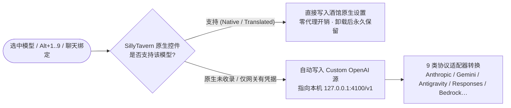

[English](./README.en.md) | [简体中文](./README.md)

<h1 align="center">OMTP Model Hub (Oh-My-Tavern-Providers)</h1>

<div align="center">

<h3>✨ 一个把 99 家服务商、5,770+ 聊天模型、OAuth 订阅登录、实时额度监控与 RP 人格八维雷达装进 SillyTavern 的模型调度中心 🎭</h3>

<p>
  <a href="https://github.com/BHLuotianyi/Oh-My-Tavern-Providers/blob/main/LICENSE">
    
  </a>
  
  
  
</p>

<p>
  
</p>

<p>
面向 SillyTavern 1.12.7 至 1.19.0+ 全系列版本，围绕「<strong>原生直写优先、本地网关兜底、角色体验可量化、凭据本机加密</strong>」持续打磨。
</p>

🛠️ <strong>Active development / 持续迭代中</strong>

</div>

---

> [!NOTE]
> **零外部依赖声明**：OMTP **不会**在你的机器上安装、启动或调用 `omp` 二进制或任何 Python 环境。
> [OMP (oh-my-pi)](https://github.com/can1357/oh-my-pi) 仅作为开源模型目录的数据来源与交互设计参考；OMTP 的客户端扩展与服务端网关均为针对 SillyTavern 独立编写的纯 JavaScript / Node.js 实现。

> [!TIP]
> **完全无损、随时可卸载**：OMTP 绝不修改 SillyTavern 核心文件，也不增删原生 `<select>` 节点。
> 原生支持的模型直接写入酒馆自身设置；进入网关模式前会自动备份你原有的 Custom OpenAI 接口配置，停用或卸载扩展时自动一键还原。

---

## 快速定位 / Start Here

- 🚀 **只想马上装好开始用？** 请直接看 [30 秒快速开始](#快速开始--getting-started) 与 [3 分钟上手指南](#3-分钟上手--quick-tour)。
- 💡 **想知道它为什么比原生下拉框好用？** 请看 [为什么选择 OMTP](#项目亮点--why-it-stands-out) 与 [核心功能一览](#核心特性--key-features)。
- 🔌 **想了解本地网关、24 条插件接口、9 类协议适配器与加密存储？** 请阅读 [docs/gateway.md](./docs/gateway.md)。
- 🛠️ **想在脚本/第三方扩展里调用 `globalThis.OMTP` 或构建目录？** 请阅读 [docs/developer.md](./docs/developer.md)。
- 🤝 **想参与贡献代码或新增服务商适配？** 请阅读 [CONTRIBUTING.md](./CONTRIBUTING.md)。

```text
OMTP Model Hub
├── 统一模型面板 (Alt+M)：99 家服务商 / 5,770 个聊天模型 / 模糊搜索 / 1–9 号快速槽位
├── 双轨智能路由：SillyTavern 原生支持则零代理直写，其余自动走本地 127.0.0.1:4100 网关
├── 角色扮演人格雷达：内置 AA-PersonalityBench 八维雷达图 + OMTP 专属 RP 加权评分
├── 订阅与密钥中心：OAuth PKCE / 设备码 / Claude Pro·Max / Codex / Antigravity / API Key
└── 实时额度与记账：16 类订阅套餐进度条、顶栏当前对话 Token/费用徽章、/omtp stats 独立统计面板
```

---

## 项目简介 / About

在 SillyTavern 原生界面中，切换一次模型往往需要「展开左侧抽屉 → 切主 API → 切聊天补全源 → 在几百个无序下拉项里翻找模型 → 手动改推理强度」，而在不同角色卡或单聊之间来回切换更是繁琐。

**OMTP Model Hub** 将整个酒馆的模型选择与服务商管理收拢进一个随时按 `Alt+M` 呼出的现代化中枢面板：

- **原生直写优先，零多余开销**：只要当前模型能被 SillyTavern 自身的 44 类原生适配器直接驱动（如 OpenAI、Anthropic、Google、DeepSeek、OpenRouter、xAI 等），OMTP 就直接写入酒馆原生设置，生成请求完全不经过任何中间代理。
- **本地网关无缝补位**：遇到酒馆原生控件未收录的新模型、或者需要特殊协议转换（如 Google Antigravity / Gemini CLI OAuth、OpenAI Responses、AWS Bedrock Converse、Vertex AI）时，自动通过内置的本机 OpenAI 兼容网关（`127.0.0.1:4100`）转发。
- **不仅能选模型，还能看哪款更适合写小说 / 跑角色卡**：直接在模型名旁显示 [AA-PersonalityBench](https://artificialanalysis.ai/evaluations/aa-personalitybench) 均分与针对角色扮演优化的 **OMTP 评分**（如 `Claude Opus 5.5`：`AA 77 · OMTP 82`）。

---

## 项目亮点 / Why It Stands Out

- **🎭 专为角色扮演定制的八维人格雷达（AA-PersonalityBench）**
  许多跑分高的编程模型在写角色卡时容易说教、讨好（迎合度高）或满嘴陈词滥调（Slop）。OMTP 内置 41 款主流模型的八维人格数据（表现力、组织性、信息量、透明度、温暖度、坚定度、想象力、套话率），并按角色扮演场景计算专属加权分：
  $$\text{OMTP RP} = 26\%\text{想象力} + 20\%\text{温暖度} + 18\%\text{表现力} + 14\%\text{不迎合度} + 7\%\text{透明度} + 6\%\text{坚定度} + 5\%\text{信息量} + 4\%\text{组织性} - 8\%\text{套话率}$$
  点击任意模型即可在右侧详情区查看八维雷达图与各项分位条，勾选顶栏「仅看有评分模型」即可秒速筛出创作主力。

- **⚡ 双轨无感切换：原生直连与 9 协议本地网关合二为一**
  你不需要关心某个模型底层走的是什么协议。点击「使用模型」后，引擎按以下决策树在毫秒级完成切换：



- **🔑 一站式登录中心（对齐 `omp /login`）**
  告别到处复制粘贴配置的烦恼。在面板的 **登录 (Sign-in)** 标签页中：
  - **OAuth 授权码（PKCE）与设备码**：支持 Claude Pro/Max、Google Antigravity、Gemini CLI、OpenAI Codex、Kilo 等订阅账号登录；点击登录立即在新标签页打开授权页，本机回环端口自动接收回调，远程部署时也支持直接粘贴回调链接。
  - **API Key 状态防呆**：已保存的密钥显示为圆点掩码，明确区分「已登录」、「未配置」与「🔴 密钥被上游拒绝（显示后四位 `****last4`）」，并提供直达各厂商控制台的领 Key 链接。
  - **一键实时探测模型（Live Probe）**：本地 Ollama / LM Studio / vLLM 或任意服务商只需点击 `🔄` 按钮，即可直接拉取上游 `/models` 实时可用列表并标记 `live` 徽章。

- **📊 16 家订阅额度监控 + 当前对话实时计费（对齐 `omp /usage` & `omp stats`）**
  - **订阅额度页**：直接读取 Claude Pro/Max、ChatGPT Codex、Antigravity/Gemini CLI、Z.AI/智谱、Kimi Code、MiniMax Token Plan、xAI SuperGrok、DeepSeek 等 16 类接口的 5 小时 / 周度配额百分比、重置倒计时与账户余额（70% 橙色预警、90% 红色告警）。
  - **顶栏实时账单徽章**：聊天顶栏常驻小徽章（如 `12.4k token · $0.018`），自动识别 Anthropic、Gemini、Bedrock、Responses API 的**缓存命中（Cache Read/Write）与思维链（Reasoning/Thoughts）Token**，按目录单价精确折算缓存折扣。
  - **独立统计大屏（`/omtp stats`）**：一行命令启动本机统计页面（默认端口 `3847`），展示 60 天柱状图、按模型/按对话成本排行，点击任意历史对话即可单看该场聊天的消耗。

---

## 快速开始 / Getting Started

环境要求：**SillyTavern >= 1.12.7**，**Node.js >= 18.0.0**。

### 🚌 宝宝巴士版教程（0 命令行 · 点击 + 复制即可）

> 适合不熟悉 Git 或命令行的朋友，全程只需用鼠标点击、复制文件夹和用记事本修改一行配置。

#### 第 1 步：下载扩展并放进酒馆（必选，30 秒完成）
1. 在本网页右上角，点击绿色的 **`Code`** 按钮 ➡️ 点击 **`Download ZIP`**（下载压缩包）。
2. 解压下载的压缩包，你会得到一个名叫 `Oh-My-Tavern-Providers-main` 的文件夹。
3. 把这个文件夹**重命名为 `omtp-model-hub`**（⚠️ 文件夹名字必须叫 `omtp-model-hub`，注意全是小写且带中划线）。
4. 打开你的 SillyTavern 酒馆文件夹（平时双击 `Start.bat` 启动酒馆的地方），依次点进目录：
   ```text
   SillyTavern/public/scripts/extensions/third-party/
   ```
5. 把刚才重命名好的 `omtp-model-hub` 文件夹直接剪切（或复制）粘贴进来。

> 🎉 到这里，刷新浏览器酒馆网页就可以用了！如果你想进一步开启 **OAuth 网页登录、实时额度条和 60 天统计大屏**，继续花 1 分钟完成第 2 步：

#### 第 2 步：开启后台网关插件（强烈推荐，解锁全部 99 家与额度统计）
1. **复制后台文件夹**：
   - 点进刚才放好的 `SillyTavern/public/scripts/extensions/third-party/omtp-model-hub/`。
   - 找到里面的 **`server-plugin`** 文件夹，鼠标右键点击它 ➡️ 选择「复制」。
   - 回到酒馆最外层的根目录（有 `Start.bat` 的地方），点进 **`plugins`** 文件夹（如果没有这个文件夹，就空白处右键新建一个叫 `plugins` 的文件夹）。
   - 鼠标右键粘贴进来，并把刚粘贴的文件夹**重命名为 `omtp`**（最终路径长这样：`SillyTavern/plugins/omtp`）。
2. **修改配置文件（只改一行）**：
   - 回到酒馆最外层根目录，找到 **`config.yaml`** 文件。
   - 鼠标右键点击它 ➡️ 选择「打开方式」➡️「记事本」（或者 VS Code / Notepad++）。
   - 按 `Ctrl + F` 快捷键搜索 `enableServerPlugins`。
   - 把 `enableServerPlugins: false` 改成：
     ```yaml
     enableServerPlugins: true
     ```
   - 按 `Ctrl + S` 保存文件并关闭记事本。
3. **重启酒馆**：关掉正在运行的酒馆黑窗口重新双击 `Start.bat`，再按 `F5` 刷新浏览器网页。打开 OMTP 面板，看到右上角亮起绿色的 **`🟢 网关: :4100`** 就大功告成了！

---

<details>
<summary><b>💻 进阶玩家：Git 命令行安装方式（点击展开）</b></summary>
<br/>

**第 1 步：克隆客户端扩展**
```bash
cd SillyTavern/public/scripts/extensions/third-party/
git clone https://github.com/BHLuotianyi/Oh-My-Tavern-Providers omtp-model-hub
```

**第 2 步：配置服务端插件**
1. 复制插件目录：
   ```bash
   cp -r SillyTavern/public/scripts/extensions/third-party/omtp-model-hub/server-plugin SillyTavern/plugins/omtp
   ```
2. 在 `SillyTavern/config.yaml` 中配置 `enableServerPlugins: true`。
3. 重启 SillyTavern 并刷新网页。

</details>
---

## 3 分钟上手 / Quick Tour

1. **呼出面板**：按快捷键 **`Alt+M`**，或点击聊天顶栏右侧的网络图标，或直接点击欢迎页上的「**OMTP 模型中心**」按钮。
2. **填入密钥或登录订阅**：切换到 **登录 (Sign-in)** 标签页，搜索你的服务商（如 `Anthropic`、`DeepSeek`、`OpenRouter`），填入 API Key 保存或点击 OAuth 登录。（*如果你已经在 SillyTavern 原生设置里填过 Key，OMTP 会自动识别并共享，无需重复填写！*）
3. **搜索并启用模型**：回到 **全部 (All)** 标签页，左侧栏上方为 **33 家核心 AI 实验室**（Anthropic、OpenAI、Google、DeepSeek、xAI、智谱、月之暗面、MiniMax、通义千问等），下方为云平台与聚合源。点击任意模型 → 右侧点击 **使用模型**（或直接按回车）。
4. **放进快速槽位**：在常用模型详情页点「**存入快速栏**」，再点顶部 `1–9` 号槽位。之后在酒馆任意界面按 **`Alt+1` ~ `Alt+9`** 即可盲切模型！
5. **绑定给当前角色或对话**：在详情页点击「**绑定角色**」或「**绑定对话**」，以后打开这名角色或这段聊天时，OMTP 会自动帮你切回专属模型与推理档位。

---

## 核心特性 / Key Features

### 🧭 四种路由徽章，一眼看清模型走哪条路

| 徽章 | 含义 | 是否需要服务端插件 | 卸载扩展后是否保留 |
|---|---|---|---|
| **Native（原生）** | SillyTavern 原生已支持该厂商且下拉框接受该模型，直写酒馆原生配置 | 否 | ✅ 永久保留 |
| **Translated（转换）** | 目录中映射到酒馆原生适配器的分站/别名（如 `minimax-cn`），直写原生配置 | 否 | ✅ 永久保留 |
| **OMTP（网关）** | 酒馆原生未收录或需协议转换的模型，通过本机 `127.0.0.1:4100/v1` 转发 | **是** | 停用时自动还原进入前的配置 |
| **Profile（档案）** | 来自 SillyTavern `Connection Manager` 扩展的连接配置档案 | 否 | ✅ 永久保留 |

### ⌨️ 斜杠命令与终端风快速选择器

| 命令 | 效果 | 示例 |
|---|---|---|
| `/omtp` | 打开 OMTP 模型中心面板 | `/omtp` |
| `/model [选择器]` | **永久切换**模型并记为默认（不带参数则打开面板） | `/model anthropic/claude-opus-5-5:high` |
| `/switch [选择器]` | **仅本次会话临时切换**，不改动默认模型；不带参数呼出极简键盘选择器 | `/switch @2` · `/switch gemini-4-argon` |
| `/effort [档位]` | 在模型支持的推理档位（`auto/min/low/medium/high/max`）间循环或直接指定 | `/effort high` |
| `/usage` | 直接打开面板的「用量与额度」页 | `/usage` |
| `/omtp stats` | 启动并在新标签页打开独立可视化 Token 统计大屏 | `/omtp stats` |

> **选择器小技巧**：`/model` 和 `/switch` 支持 `provider/model`、模糊模型名、`@1`~`@9`（快速槽位）、`@fav`（首个可用收藏模型）、`@recent`（首个可用最近模型），以及 `:high` 等推理后缀。

### 🛠️ 面向进阶玩家的精细控制

- **推理强度按模型独立记忆**：在详情页或用 `/effort` 为 `Claude Opus 5.5`、`DeepSeek V4.1 Flash`、`Gemini 4 Argon` 等模型设定的推理档位会按模型独立保存，切回时自动恢复并同步写入 `openai_reasoning_effort`。
- **自定义附加请求体（Extra Body JSON）**：点击详情页「编辑附加请求体」，可为单个模型注入自定义 JSON 参数（如特定采样参数或上游扩展字段），生成时自动深度合并，同时严密保护 `model`、`messages`、`stream` 等核心路由字段不被误覆盖。
- **主流过滤与中文译名开关**：面板右上角支持一键切换「仅显示主流供应商（52 家）」、「仅看有评分模型」以及「显示供应商官方中文名（如深度求索、月之暗面、智谱、硅基流动）」。
- **与本地 OMP 无缝联动**：如果你本机安装了 `oh-my-pi`，可在「扩展设置 → OMTP Model Hub → 导入本地 OMP」中一键导入本地模型覆盖层，并可选将 `~/.omp/agent/agent.db` 中的 API Key 与 OAuth 会话（含 Antigravity、Gemini CLI、Anthropic）直接导入 OMTP 加密密钥库。

---

## 隐私与安全边界 / Privacy & Security

- **凭据不出本机**：所有通过 OMTP 录入的 API Key、OAuth 刷新令牌与自定义服务商配置均使用 **AES-256-GCM**（主密钥 `data/omtp/master.key`，权限 `0600`）加密保存在 `data/omtp/providers.json`。HTTP 管理接口永远只返回凭据来源与末四位字符。
- **不内置任何第三方 OAuth Client Secret**：仓库源码与目录均不携带任何 OAuth 客户端密钥。如需使用自定义 OAuth 客户端，可通过环境变量 `OMTP_<PROVIDER>_CLIENT_ID` 或本地 `data/omtp/oauth-clients.json`（权限 `0600`，已 gitignore）自行注入。
- **零遥测、零云端中转**：OMTP 不包含任何统计上报、遥测或第三方代理服务器；网关仅监听 `127.0.0.1`，所有上游请求均由你的机器直连目标服务商官方端点。

---

## 常见问题 / FAQ

<details>
<summary><b>Q1：安装 OMTP 需要安装 Python 或预先安装 OMP (oh-my-pi) 吗？</b></summary>
<br/>
完全不需要。OMTP 是纯 JavaScript / Node.js 编写的 SillyTavern 原生扩展与插件，内置了完整的 99 家服务商目录与人格评分快照，开箱即用。
</details>

<details>
<summary><b>Q2：为什么有些模型搜得到，但显示“不可用 / 无密钥”或按钮灰掉？</b></summary>
<br/>
常见原因有三种，详情面板会直接写出具体原因：
<ol>
  <li><b>未配置密钥</b>：点击详情页下方的「打开登录页」填入 API Key 或完成 OAuth 登录即可解锁。</li>
  <li><b>未开启服务端插件</b>：标有 <code>OMTP</code> 徽章的模型需要本地网关转发，请按上方「第二步」复制 <code>server-plugin</code> 并开启 <code>enableServerPlugins: true</code>。</li>
  <li><b>专有客户端协议</b>：极少数仅支持专有客户端协议的服务商（如 Cursor、Devin、GitHub Copilot 聊天等）无法通过无头网关转发，面板会保留展示并注明原因。</li>
</ol>
</details>

<details>
<summary><b>Q3：SillyTavern 原生那个长长的 API 选择器去哪了？怎么找回来？</b></summary>
<br/>
OMTP 默认通过给 <code>&lt;body&gt;</code> 添加 CSS 类隐藏了原生选择器以保持界面清爽，并未删除任何 DOM 节点。你可以随时在「API 抽屉顶部 → 显示原生 API 选择器」或「扩展设置 → 隐藏原生 API 选择器」中一键恢复。
</details>

<details>
<summary><b>Q4：为什么目录里没有画图（Image）、语音（TTS/ASR）或向量嵌入（Embedding）模型？</b></summary>
<br/>
OMTP 专注于 SillyTavern 的对话与角色扮演文本生成体验，目录构建流水线会过滤非对话模态（仅保留 <code>kind: 'chat'</code>），避免数千个嵌入/语音条目干扰搜索。
</details>

---

## 进阶文档与开发导航 / Documentation

| 文档 | 内容概览 |
|---|---|
| 🔌 [**本地网关与服务端架构参考 (docs/gateway.md)**](./docs/gateway.md) | 网关端口与鉴权、24 条插件 HTTP 路由、9 类协议适配器、16 家实时额度接口、`data/omtp/` 文件规格 |
| 🛠️ [**开发者 API 与构建指南 (docs/developer.md)**](./docs/developer.md) | `globalThis.OMTP` 完整方法与事件、选择器语法规则、目录与人格快照构建脚本、本地 Mock 零成本调试 |
| 🧪 [**端到端验证清单 (tests/e2e/README.md)**](./tests/e2e/README.md) | 在 SillyTavern 中手工验证原生路由、网关流式转发、绑定与清理回滚的步骤说明 |
| 🤝 [**贡献指南与模块架构 (CONTRIBUTING.md)**](./CONTRIBUTING.md) | 仓库目录全景、双层独立契约、质量护栏、代码风格与 PR 提交流程 |
| 📚 [**OMP 模型选择参考笔记 (model-selection-omp/)**](./model-selection-omp/README.md) | 上游 `oh-my-pi` 模型选择器架构与优先级设计参考资料 |

---

## 致谢与许可证 / Credits & License
<table>
<tr>
  <td><a href="https://github.com/can1357/oh-my-pi"><b>OMP (oh-my-pi)</b></a></td>
  <td>✨ 本项目的网关、登录流（<code>/login</code>）、额度页（<code>/usage</code>）与统计大屏（<code>stats</code>）设计均致敬并对齐 OMP；内置模型目录由 OMP 的 <code>models.json</code>（MIT License）衍生构建，详见 <a href="./NOTICE">NOTICE</a>。</td>
</tr>
<tr>
  <td><a href="https://artificialanalysis.ai/evaluations/aa-personalitybench"><b>AA-PersonalityBench</b></a></td>
  <td>📊 模型八维人格评估与分位数据来源（Artificial Analysis）。</td>
</tr>
<tr>
  <td><a href="https://github.com/SillyTavern/SillyTavern"><b>SillyTavern</b></a></td>
  <td>🍺 强大的开源前端酒馆宿主环境。</td>
</tr>
</table>

本项目基于 [**GNU General Public License v3.0 (GPL-3.0)**](./LICENSE) 开源许可证发布，版权所有 © 2026 [BHLuotianyi](https://github.com/BHLuotianyi)。

<div align="center">
<br/>
<p>
本项目为 <strong>屎山酒馆拯救计划 (SpaghettiTavern Saving Plan)</strong> 的一部分<br/>
<em>“愿我们能在星空的彼方再次相遇”</em>
</p>
</div>
