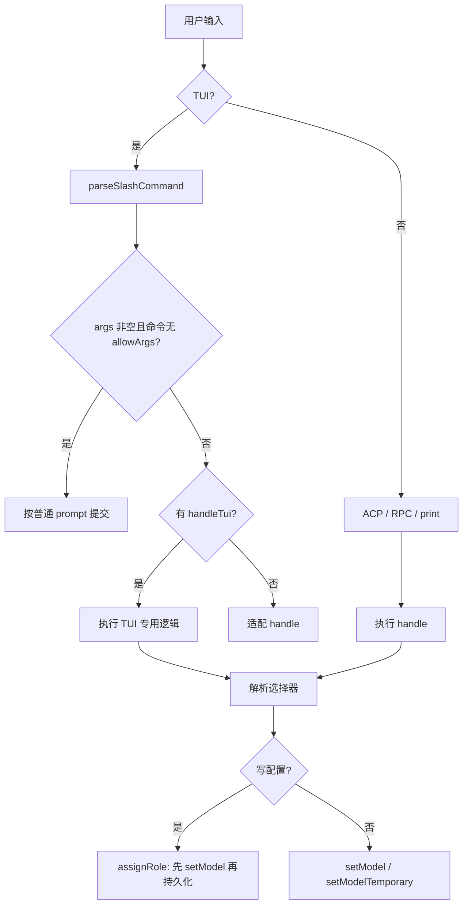

# 命令与外部表面

模型选择有多个入口，但它们最终只走两条变更路径：**持久化角色**或**会话临时模型**。本文按用户可见表面拆解。

## 1. 命令分发骨架

斜杠命令定义集中在 `slash-commands/builtin-modes.ts` 的 `BUILTIN_MODE_SLASH_COMMANDS`，由 `builtin-registry.ts` 分发：

```text
TUI:
  input-controller submit
    → executeBuiltinSlashCommand(text, {ctx, input, draftDetached})
    → parseSlashCommand: 在首个空白或 ":" 处切出 name/args
    → lookup(name 或 alias)
    → 若 args 非空且命令没有 allowArgs → 返回 false（当作普通 prompt）
    → 优先 handleTui；没有则把 handle 适配到 TUI

ACP / RPC / print:
  executeAcpBuiltinSlashCommand
    → 只执行带 handle 的命令；不检查 allowArgs
    → 返回 consumed 状态
```



关键差异：

- **`allowArgs` 是 TUI 的硬门槛**。`/model` 没有 `allowArgs`，所以 TUI 里 `/model opus` 不是内置命令，会被当成用户消息发给模型。
- `handle`（ACP/文本）与 `handleTui` 可以语义完全不同，`/model` 就是典型。
- `parseSlashCommand` 也把 `:` 当作分隔符，因此 `/model:opus` 等价于 `/model opus`。
- Collab guest 只能执行只读白名单；`model`、`switch`、`effort` 等会被拒绝并提示 host-only。

## 2. 命令总表

| 命令 | 别名 | 参数 | TUI 行为 | ACP/文本行为 | 是否写配置 |
|---|---|---|---|---|---|
| `/model` | `/models` | TUI 无；ACP 有 | 打开模型中心（hub）或选择器 | 有参：直接切会话模型；无参：显示当前模型 | TUI hub 可写角色；ACP 命令不写 |
| `/switch` | — | `[model]` | 无参打开临时选择器；有参解析并切换 | 同左，但打印当前模型 | 否 |
| `/modelpreset` | — | `list/save/switch/delete [name]` | 列表/保存/切换/删除预设 | 同左 | save/switch 写角色与 thinking |
| `/effort` | — | `[level]` | 无参打开 thinking 选择器 | 显示/设置 thinking | 否（只写会话日志） |
| `/fast` | — | `[on\|ultra\|off\|status]` | 切换 service tier | 同左 | 否（会话内） |
| `/slow` | — | `[on\|off\|status]` | 切换 flex/低优先级 | 同左 | Anthropic 分支写全局设置 |
| `/extended-context` | — | `[on\|off\|status]` | 切换扩展上下文 | 同左 | 是（持久化 setting） |
| `/prewalk` | — | `[restart\|off]` | 预走（planning → 执行）模型切换 | 同左 | 否 |
| `/agents` | — | — | 配置子代理模型（不属本文核心） | 同左 | 是 |

**没有 `/thinking`**（thinking 命令叫 `/effort`），**没有 `/cycle`**（循环是 `ctrl+p` 键位/RPC）。

## 3. `/model`

### 3.1 TUI

```text
/model            → ctx.showModelSelector()
                     ├─ focusedAgentId 存在 → 临时选择器（只影响被查看的 agent）
                     └─ 否则 → 全屏 Model Hub
/model <anything> → 不是内置命令 → 作为普通 prompt 提交
```

Model Hub 的语义（`modes/controllers/selector-controller.ts:927-1050`）：

- 角色视图：给 `default`、`smol`、`slow`、`plan`、`task`、`judge` 等角色选模型。
- 选中后写 `modelRoles.<role>`；`default` 角色还会立即切换当前会话。
- 作用域由 `modelRoleStorage` 决定：
  - `global`（默认）：写全局 `config.yml`；
  - `project`：写 `<cwd>/.omp/config.yml`，可选择 global/project 目标；当项目值遮蔽全局时，清理逻辑会维护 runtime override 槽位。
- 非 `default` 角色只改配置，不动当前会话模型。
- Hub 还管理 `retry.fallbackChains`、模型预设、provider 登录、刷新发现。
- 在子代理视图中 `/model` 强制走临时选择器，因为 hub 分配的是主会话/未来 spawn 的角色，不是当前被查看 agent 的模型。

Hub 的 `onAssign` 对 `default` 的细节（`:947-1010`）：

- `thinkingLevel === auto` → 配置当前会话 + `defaultThinkingLevel = auto`；其它角色只持久化 `:auto` 后缀。
- 目标作用域是 global 时，调用 `session.setModel(model, "default", { persist: true })`。
- 目标作用域是 project 时，`setModel` 不落盘，随后单独 `setProjectModelRole`。
- 若更高层（project/overlay/runtime）已经遮蔽该角色，则改写对应层，避免"写了但不生效"。

### 3.2 ACP / 文本

`builtin-modes.ts:465-493`：

- 有参：`resolveSessionModelSelector` → `resolveCliModel`；失败只报 `Unknown model: <sel>`（丢弃更具体的 `error`）。
- 成功：`session.setModel(match)`（默认角色，`persist` 未传 → **不写配置**），再应用 `:level`，输出 `Model set to p/i.`。
- 无参：输出 `Current model: p/i` 或 `No model is currently selected.`。

这就是"`/model` 在 ACP 里是切会话，在 TUI 里是改角色"的根源。

## 4. `/switch`

语义明确：**只影响当前会话**。

### 4.1 选择器解析

两条路径共用 `resolveSessionModelSelector`（`builtin-modes.ts:60-73`）：

```ts
resolveCliModel({
  cliModel: selector,
  modelRegistry: session.modelRegistry,
  availableModels: scopedModels.length > 0 ? scopedModels : undefined,
  settings,
  preferences: getModelMatchPreferences(settings),
})
```

因此它和 `--model`、`omp bench` 的语法完全一致：

- 精确 `provider/id`
- 模糊 id（`opus`）
- 角色别名（`@smol`，以及配置存在的裸名 `smol`）
- `:level` 后缀
- 未限定选择器优先 session 的 `--models` 作用域，其次已认证集合，最后完整 catalog

### 4.2 TUI 行为

```text
/switch            → showModelSelector({ temporaryOnly: true })
                     → 临时选择器（alt+p 同一组件）
/switch <selector> → 解析
                     → warning 显示到状态栏
                     → ctx.switchSessionModel(model, level)
```

`switchSessionModel` 还会处理"目标模型上下文窗口装不下当前 transcript"：

- 计算当前 context tokens 与目标 `contextWindow`；
- 超限则先执行压缩（`handleCompactCommand`），压缩成功后才切换；
- 压缩被取消或失败 → 保持原模型；
- 焦点在子代理时直接切换，不压缩（子代理自己的上下文维护负责恢复）。

切换成功后输出 `Session-only model: p/i. Use <key> or /model for roles.`。

### 4.3 ACP 行为

`session.setModelTemporary(model, thinkingLevel)`：

- 不写 settings；
- 会话日志角色记为 `"temporary"`；
- 记录 MRU；
- 不做"先压缩"（压缩由调用方/上层决定）。

## 5. 两个选择器 UI：Hub 与 Picker

| | Model Hub | Model Picker |
|---|---|---|
| 打开方式 | `/model`（TUI）、`alt+m`、状态栏模型段 | `/switch`（TUI 无参）、`alt+p`、`app.model.selectTemporary` |
| 形态 | 全屏 alternate screen | 底部浮层 |
| 作用 | 角色分配、预设、fallback 链、provider 登录、刷新 | 只切当前会话 |
| 是否持久化 | 是（按 `modelRoleStorage`） | 否 |
| 角色行 | 直接编辑角色 | 虚拟 `@role` 快捷行 + 快捷角色循环 |
| 超上下文 | 由 `setModel` 路径处理，不主动压缩 | 超限时先压缩再切 |
| 子代理 | 强制退化为 picker | 正常 |

Picker 的额外语义：

- 快捷角色来自 `cycleOrder`，默认 `["smol", "default", "slow"]`。
- 选中角色行调用 `applyRoleModel`，等价于把会话切到该角色解析出的模型（仍不写配置）。
- Task 行只写 runtime override（session-only），提示用 `/agents` 持久化。
- 选中 `@role` 行不是"选模型"，而是"应用角色"。

## 6. 键位与循环

| 键位 | 动作 | 代码 |
|---|---|---|
| `alt+m` | 打开 Hub | `app.model.select` |
| `alt+p` | 打开临时 Picker | `app.model.selectTemporary` |
| `ctrl+p` | 下一个角色模型 | `app.model.cycleForward` |
| `shift+ctrl+p` | 上一个角色模型 | `app.model.cycleBackward` |
| `shift+tab` | 循环 thinking 级别 | `app.thinking.cycle` |
| `ctrl+t` | 切换 thinking 开关 | `app.thinking.toggle` |

`ctrl+p` 的语义是"角色循环"，不是"所有模型循环"：

1. 用 `cycleOrder` 解析每个角色的模型；
2. 跳过未配置/不可用的角色；
3. 用最后一次 `model_change` 的角色定位当前位置，但仅当该角色当前模型仍等于活动模型时才信任；
4. 否则按活动模型查找；再不行从 0 开始；
5. `applyRoleModel` → `setModel`（不持久化）+ 显式 thinking。

只有没有角色可循环时，才退化为 `cycleModel`（scoped 优先，否则所有可用模型）。

## 7. `/modelpreset`

预设是 `modelRoles` + `defaultThinkingLevel` 的整份快照。

- 存储：全局 `config.yml` 的 `modelPresets.<name>`；项目/`--config` 也可定义，同名**整体覆盖**而不是深合并。
- 名字规则：`^[a-zA-Z][\w-]*$`。
- `save`：捕获当前有效 roles（丢弃空值）与 `defaultThinkingLevel`，只写这一条。
- `switch` 的顺序很重要：
  1. 先用"预设自身 roles 覆盖当前 roles"的视图解析其中的 `default`；
  2. 校验该模型可用且有凭据；失败返回 `unavailable`，**配置完全不动**；
  3. 把 roles 写入 `modelRoleStorage` 对应作用域；预设未包含的角色会被清掉；
  4. 若预设记录了 `defaultThinkingLevel`，写入该值；
  5. 解析实际切换目标，`session.setModel(..., { persist: false })`；
  6. 应用 thinking；
  7. 报告被更高层遮蔽的 role/thinking（`shadowed` / `shadowedThinking`）。
- `delete`：只能删全局层的同名条目；如果项目层仍定义，返回 `"project"` 而不是 `"deleted"`。
- `list`：按名字排序，跳过被上层 tombstone 隐藏的条目。

预设有多个结果态：`switched` / `missing` / `invalid` / `unavailable` / `failed`。移植时应保留这种"部分成功"表达能力。

## 8. thinking 与 provider 模式命令

### `/effort`

- 无参：TUI 打开 thinking 选择器；ACP 输出 `Thinking: <level>` 与 `Available: ...`。
- 有参：只接受模型实际支持的档位；否则 `Unknown thinking level: x. Available: ...`。
- 只写会话日志，不写配置。
- `shift+tab` 走 `cycleThinkingLevel`，顺序是 `off → auto → ...efforts`（模型不验证 thinking 时省略 auto）。

### `/fast`

- `on`：当前模型家族的 `priority` tier；`ultra/ultrafast`：OpenAI/Codex 的 ultrafast；`off` 清除；`status` 显示 `ultra|on|off`。
- 实际值是 per-family service tier，写会话日志 `service_tier_change`，**不写配置**。
- 不支持时返回 `Fast mode is unavailable for the current model.`。

### `/slow`

- OpenAI/Google：`flex` tier，会话级。
- Anthropic：低优先级车道，且写全局 `providers.anthropic.slowMode`；这是少数会持久化的"运行时模式"。
- 不支持时返回统一的 `SLOW_UNSUPPORTED` 文案。

### `/extended-context`

- 切换持久化 setting `extendedContext`。
- 触发模型窗口策略重算；必要时重新绑定当前模型（同模型不会重置 provider session）。

## 9. CLI 表面

| Flag | 语义 |
|---|---|
| `--model <sel>` | 用 `resolveCliModel` 解析；成功后设为运行时会话模型，并临时覆盖 `modelRoles.default`（不落盘）；`:level` 作为 thinking 种子 |
| `--provider <name>` | 旧参数；只有和 `--model` 同时出现才参与解析 |
| `--models a,b,c` | Ctrl+P / `/models` 作用域（glob 允许），无 `--model` 时也决定初始模型 |
| `--smol` / `--slow` / `--plan` | 对应角色的运行时覆盖；不落盘 |
| `--thinking <level>` | 最高优先级 thinking 种子 |
| `--api-key <key>` | 运行时凭据覆盖；必须配合模型选择器；不持久化 |
| `--service-tier <tier>` | OpenAI service tier 初值 |

没有 `--list-models`；列模型用 `omp models`。`docs/models.md` 中旧的 `findInitialModel` 顺序已不再被启动路径调用。

其他命令：

- `omp models [ls|list|find|<provider>] [pattern] [--json] [--kind <kind>]`：列 catalog；`refresh` 会强制在线刷新并可重跑 `!cmd` 凭据。
- `omp bench <models...>`：用完整 catalog 解析选择器，再对无凭据的候选做等价 provider 重定向。
- `omp tiny-models`：本地 tiny 模型，和 provider 选择无关。

## 10. ACP 与 RPC

### ACP

- 模型列表通过 `session/new|load|resume|fork` 返回的 `configOptions` 发布：
  - `configId: "model"`，值是 `provider/id`；
  - 候选来自 `session.getAvailableModels()`（已应用 `enabledModels`）。
- 设置模型走 `session/set_config_option`：

```json
{ "sessionId": "...", "configId": "model", "value": "provider/id" }
```

- 校验：必须在当前可用列表中精确匹配，否则 JSON-RPC 错误 `Unknown ACP model: ...`。
- 效果：`session.setModel(model)`，**不写 settings**；会话日志、MRU、thinking 重绑照常。
- thinking 同样走 `configId: "thinking"`。
- 注意：仓库里没有 ACP 的 `session/setModel` 方法；`/model` 的错误文案是旧描述。

### RPC

- `set_model { provider, modelId }`：精确匹配可用模型；缺失会后台刷新重试一次；成功等价于 `session.setModel`（不落盘）。
- `cycle_model`：优先 scoped，否则所有可用模型；只有一个时返回 null。
- `get_available_models`：返回可用列表。
- `open_session` / `switch_session`：可带 `provider` + `modelId`（必须成对），切换会话时应用。
- thinking：`set_thinking_level`、`cycle_thinking_level`、`get_available_thinking_levels`（不暴露 `auto`/`inherit`）。

## 11. 移植时最重要的三个坑

1. **不要做一个"既持久化又临时"的命令。** 明确拆成 `assignRole` 与 `setSessionModel`；`/model` 在 OMP 里的双重语义是历史造成的，不建议照搬。
2. **TUI 的 `allowArgs` 门槛容易造成"命令静默变成 prompt"。** 新设计里要么总是接受参数，要么显式拒绝并提示用法。
3. **命令层的错误必须保留解析器的具体原因。** OMP 的 `/model`/`/switch` 丢弃了 `disabled provider` 等细节，只显示 `Unknown model`；移植时应保留 `error` 字段。
