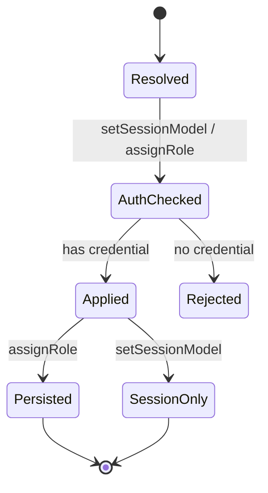

# 移植蓝图：把模型选择搬到非 CLI 系统

本文不复述 OMP 的 UI，而是给出可落地的最小架构。目标是保留它真正有价值的部分：**选择器语法、可用性判定、角色解析、持久化/临时分离、thinking 独立轴**。

## 1. 模块边界

建议拆成五个模块，依赖方向单向：

```text
catalog/registry  →  resolver  →  session-model  →  surface (UI/API)
        ↑                ↑
     auth/config     settings
```

| 模块 | 职责 | 不应包含 |
|---|---|---|
| Registry | 聚合模型来源、计算可用性、按 id 查找、上下文窗口策略 | 角色、用户偏好、会话状态 |
| Resolver | 选择器语法、匹配、优先级、角色展开、作用域过滤 | 读写会话、发事件 |
| Settings | 角色/白名单/预设/回退链的持久化与分层 | 直接调用模型 API |
| SessionModel | 当前模型 + thinking + 服务层级 + 切换副作用 + 日志 | UI 交互 |
| Surface | 命令/API/选择器 | 解析逻辑 |

这样做的直接好处：Resolver 可以纯函数化；SessionModel 可以在测试里用假 agent；UI 不需要知道 `:max` 与字面 id 的区别。

## 2. 核心类型

```ts
interface Provider {
  id: string;
  priority: number;          // 低于内置顺序时用于 tie-break
  automaticDefault: boolean; // false = 只能显式选择
}

interface Model {
  provider: string;
  id: string;
  name?: string;
  kind: "chat" | "tiny" | "image" | "tts" | "stt" | "search" | "judge" | ...;
  api: string;
  contextWindow: number;
  maxContextWindow?: number;
  reasoning: boolean;
  thinking?: {
    defaultLevel?: Level;
    efforts?: Level[];
    unverified?: boolean;
    effortRouting?: Record<Level, string>;
  };
  isProviderDefault?: boolean;
}

type Level = "off" | "minimal" | "low" | "medium" | "high" | "xhigh" | "max";
type ConfiguredLevel = Level | "auto" | "inherit";

interface ResolvedSelection {
  model?: Model;
  thinkingLevel?: ConfiguredLevel;
  explicitThinkingLevel: boolean;
  matchedPatternIndex?: number;
  warning?: string;
  error?: string;
}

interface RoleConfig {
  roles: Record<string, string>;      // role -> selector
  presets: Record<string, { roles: Record<string, string>; defaultThinkingLevel?: ConfiguredLevel }>;
  enabledModels: string[];
  disabledProviders: string[];
  providerOrder: string[];
  cycleOrder: string[];
  defaultThinkingLevel: ConfiguredLevel;
  fallbackChains: Record<string, string[]>;
}

interface SessionModelState {
  model?: Model;
  configuredThinking: ConfiguredLevel; // 可能是 auto
  resolvedThinking?: Level;            // auto 的当前解析值
  serviceTierByFamily: Record<string, string>;
}
```

## 3. 解析器伪代码

### 3.1 单 pattern

```ts
function resolvePattern(pattern: string, pool: Model[], prefs: Prefs): ResolvedSelection {
  // 1. 完整精确引用（provider/id，含别名/路由/日期回退）
  const exact = findExactReference(pattern, pool);
  if (exact) return { model: exact, explicitThinkingLevel: false };

  // 2. 模板代码：先当字面 id，再当 thinking 后缀
  const literal = matchFuzzy(pattern, pool, prefs); // 不清洗后缀
  if (literal && literal.id.toLowerCase().endsWith(":" + suffixOf(pattern))) {
    return { model: literal, explicitThinkingLevel: false };
  }

  const { base, level } = splitThinkingSuffix(pattern, { allowMax: true, allowAuto: true });
  if (level) {
    const inner = resolvePattern(base, pool, prefs);
    if (inner.model) {
      return {
        model: inner.model,
        thinkingLevel: inner.warning ? undefined : level,
        explicitThinkingLevel: !inner.warning,
        warning: inner.warning,
      };
    }
    return inner;
  }

  // 3. 模糊/子串
  const fuzzy = matchFuzzyOrSubstring(pattern, pool, prefs);
  if (fuzzy) return { model: fuzzy, explicitThinkingLevel: false };

  // 4. 非法后缀 → 递归前缀 + warning
  if (pattern.includes(":")) {
    const inner = resolvePattern(pattern.slice(0, pattern.lastIndexOf(":")), pool, prefs);
    if (inner.model) return { ...inner, warning: `Invalid thinking level ...` };
  }
  return {};
}
```

### 3.2 角色值

```ts
function resolveRoleValue(value: string, pool: Model[], cfg: RoleConfig): ResolvedSelection {
  if (!value || value === "default") return {};             // 未配置
  const patterns = expandRolePatterns(value, cfg);          // 展开 @role、嵌套、:level
  let firstWarning;
  for (const [i, p] of patterns.entries()) {
    const r = resolvePattern(p, pool, prefs);
    if (r.model) return { ...r, matchedPatternIndex: i };
    firstWarning ??= r.warning;
  }
  return { warning: firstWarning };
}
```

`expandRolePatterns` 的顺序必须是：

```text
配置值（可逗号链）
  → 角色专属 configured fallback（tiny→smol 等）
  → 仅 smol/slow：已配置的 default
  → 内置默认链
  → 仍为空：无模型
```

不要把它实现成"递归解析直到找到模型"——那会在环或空配置时无限回退。用 `visited` 集合，遇到环就替换为当前角色的内置链。

### 3.3 自动挑选

```ts
function pickAutomatic(pool: Model[], hasConcreteCredential: (p: string) => boolean): Model | undefined {
  const candidates = pool.filter(m => provider(m.provider).automaticDefault !== false);
  const concrete = candidates.filter(m => hasConcreteCredential(m.provider));
  const scope = concrete.length > 0 ? concrete : candidates;
  const providerDefaults = scope.filter(m => m.isProviderDefault);
  const preferred = providerDefaults.length > 0 ? providerDefaults : scope.filter(isBundledDefault);
  // 同名默认按 provider 优先级；否则取第一个
  return sortByProviderPriority(preferred)[0] ?? scope[0];
}
```

### 3.4 作用域过滤

```ts
function withinScope(models: Model[], patterns: string[], cfg: RoleConfig): Model[] {
  if (patterns.length === 0) return models;      // 空 = 不限制
  return models.filter(m =>
    patterns.some(p => globMatches(p, `${m.provider}/${m.id}`) || globMatches(p, m.id))
  );
}
```

注意：`enabledModels` 空数组是"不限制"，但**非空且无匹配**是"无可用模型"，不能回退全局默认。

## 4. 会话 API 设计

不要把 `persist` 做成一个布尔开关塞进 `setModel`。建议两个方法 + 一个角色分配方法：

```ts
interface SessionModelApi {
  // 只影响当前会话：写日志、MRU、thinking 重绑、事件
  setSessionModel(model: Model, thinking?: ConfiguredLevel): Promise<void>;

  // 持久化角色；default 角色同时切换当前会话
  assignRole(role: string, model: Model, thinking?: ConfiguredLevel): Promise<void>;

  clearRole(role: string): Promise<void>;

  // 可选：一次写多个角色（预设）
  applyPreset(name: string): Promise<PresetResult>;
}
```

内部状态机：



关键顺序（不要交换）：

1. **凭据检查在变更前**，否则会出现"UI 已显示新模型但请求必失败"。
2. **关闭旧 provider 会话**在 `agent.setModel` 之前。
3. **写日志**在应用之后、事件之前；这样订阅者看到事件时日志已一致。
4. **持久化**在应用成功之后；失败不应写配置。
5. **thinking 重绑**在模型应用之后，因为它依赖新模型的能力。
6. **system prompt / tool set 重建**在最后。

## 5. 配置模型

建议 schema：

```yaml
model:
  roles:
    default: anthropic/claude-opus-5
    smol: google/gemini-3.8-flash:high
    slow: openai/gpt-5.6-sol
    judge: typesafe/jev-1.14.0
  defaultThinkingLevel: high
  enabledModels: []          # 空 = 不限制
  disabledProviders: []
  providerOrder: []
  cycleOrder: [smol, default, slow]
  roleStorage: global        # 或 project
  presets:
    fast:
      roles: { default: "...", smol: "..." }
      defaultThinkingLevel: low
  fallbackChains:
    default: [openrouter/..., anthropic/...]
```

如果支持项目级，保留"项目值可清除并回退全局"的墓碑语义；否则直接合并成一个 map。

## 6. 错误模型

| 错误 | 何时 | 建议呈现 |
|---|---|---|
| `UnknownModel` | 选择器无匹配 | 回显原始选择器 + 可用示例 |
| `UnknownProvider` | `provider/id` 的 provider 不存在 | 列出 provider |
| `ProviderDisabled` | 命中 disabledProviders | 明确指出该 provider 被禁用 |
| `NoCredential` | 模型存在但不可用 | 提示配置凭据，不要静默换模型 |
| `InvalidThinkingSuffix` | 后缀非法但前缀可解析 | warning + 使用默认 thinking |
| `ScopeEmpty` | 白名单无匹配 | "无可用模型"，不要回退全局 |
| `PresetUnavailable` | 预设的目标不可用 | 不修改任何配置 |

`warning` 与 `error` 要分开：非法后缀是 warning，选择器完全无效是 error。OMP 的命令层把两者混在一起（`/model` 丢弃 error 细节），移植时不要照抄。

## 7. 事件

最小事件集：

```ts
type ModelEvent =
  | { type: "model_changed"; model: string; role?: string }
  | { type: "thinking_level_changed"; configured: ConfiguredLevel; resolved?: Level }
  | { type: "retry_fallback_applied"; model: string; from?: string }
  | { type: "config_changed"; scope: "global" | "project" };
```

约束：

- `model_changed` 只在模型**真的变化**时发；同模型改窗口/thinking 不发。
- 事件必须同步发出（至少在状态更新后立即），否则 UI 与请求可能读到不同模型。
- ACP/RPC 的 config option 更新由 `model_changed` 驱动，不要在每个调用点手动推。

## 8. 测试矩阵

按"消费者能观察到什么"设计，而不是按内部函数。

### 选择器

| 用例 | 断言 |
|---|---|
| `openrouter/z-ai/glm-4.7` | 解析为 provider `openrouter`，id 保留斜杠 |
| `glm-5.3:max` 且 catalog 有该字面 id | 解析为字面 id，thinking 不设置 |
| `glm-5.3:max` 且无字面 id | 解析为 `glm-5.3` + max |
| `kimi-for-coding:high` | 不命中 `kimi-for-coding-highspeed` |
| `openrouter/x@cerebras`（非聚合器） | `@` 保留在 id 中或按字面处理 |
| `@smol:high` | 级别传播到每个候选 |
| `@unknown` | 不作为角色，正常失败 |
| `openai/*` 在 `modelRoles` | 不当作 glob |

### 解析

| 用例 | 断言 |
|---|---|
| 同 id 多 provider + `provider/id` | 锁定指定 provider |
| 裸 id 多匹配 | MRU 优先，其次 provider 顺序，其次注册顺序 |
| disabled provider + 显式选择 | 返回明确错误，不换模型 |
| 无凭据模型 | `setSessionModel` 抛错，状态不变 |
| `enabledModels: []` | 不限制 |
| `enabledModels: ["x/*"]` 无匹配 | 空集，不回退 |
| 无 default 角色 | 自动挑选；不伪造模型 |

### 角色

| 用例 | 断言 |
|---|---|
| 未配置 `@default` | 无模型 |
| 只配置 default，`@smol` | 先继承 default，再内置链 |
| `@tiny` 未配置 | 先配置的 smol，再 smol 链 |
| `@advisor` 未配置 slow | 不继承主模型，走 slow 内置链 |
| 角色互相引用成环 | 终止并回退内置链 |
| `@judge` 链 | `@tiny`/`@smol`/`@default` 被展开而不是字面匹配 |

### 会话

| 用例 | 断言 |
|---|---|
| `setSessionModel` | 不写角色配置；写日志；MRU 更新；事件发出 |
| `assignRole(default)` | 写角色配置；当前模型切换；重启后生效 |
| `assignRole(smol)` | 不改当前模型 |
| 切换 `auto` 会话后恢复 | 仍为 auto，而不是具体档位 |
| 超上下文 + `/switch` | 先压缩；取消则保持原模型 |
| 显式切换后失败请求 | 不触发旧回退链 |
| 同模型改 thinking | 不重置 provider session |

### 配置

| 用例 | 断言 |
|---|---|
| env/runtime/project/global 同键 | 优先级正确 |
| 数组跨层 | 整体替换，不合并 |
| 项目 `modelRoles.x = null` | 回退 global |
| 同名预设跨层 | 高层整体胜出，不合并 |
| 删除被项目定义的预设 | 返回 `project`，不谎报删除 |

## 9. 反模式

- **在 UI 层解析选择器**：会导致 CLI 与 UI 行为分叉。
- **用"是否找到模型"决定是否回退全局默认**：白名单场景必须区分"未设置"与"设置为空"。
- **把 `auto` 当作 `Effort`**：provider 会收到非法值；必须保持编码层哨兵。
- **在模型切换时重建整个会话**：只需重建模型依赖部分（窗口、tokenizer、prompt、provider session）。
- **让持久化角色与临时模型共用一个方法**：`persist` 布尔迟早会被传错。
- **按 provider 名字硬编码行为**：OMP 把模型/提供商策略放在 catalog/KDL；移植时至少把"家族默认 tier、自动选择资格、窗口上限"做成数据，而不是 if/else。

## 10. 落地顺序

1. 定义 `Model` / `Registry` / 可用性谓词，能列出"有凭据的模型"。
2. 实现词法层：`provider/id`、`:level`、`@upstream`。
3. 实现 `matchExact → 模糊 → 子串` 与偏好排序。
4. 实现角色展开与内置默认链（先硬编码，后续数据化）。
5. 实现 `resolveRoleValue` + `resolveCliModel` 风格的统一入口。
6. 实现 `SessionModel`：两个变更 API、日志、thinking、事件。
7. 接入持久化层：global/project（或单层）+ runtime override。
8. 最后做 UI/命令；每层都有独立契约测试。
