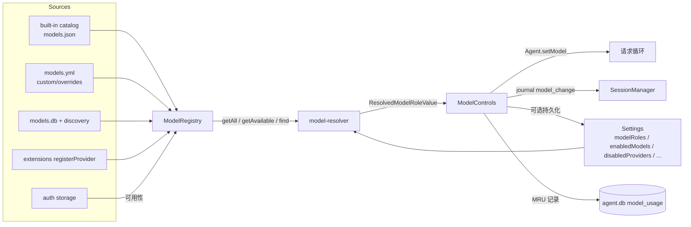

# OMP 模型选择体系：操作逻辑与业务代码拆解

本目录把 `packages/coding-agent` 里"用户如何选模型、系统如何解析、状态如何生效与持久化"完整拆开，供在非 CLI 环境下复用同一套设计。所有结论都对照源码核对过，行号基于当前工作树。

## 阅读顺序

| 文档 | 内容 |
|---|---|
| [01-selector-grammar.md](./01-selector-grammar.md) | 选择器字符串语法（`provider/id`、模糊 id、`:level`、`@role`、`@upstream`、glob、逗号链） |
| [02-resolution-algorithm.md](./02-resolution-algorithm.md) | 解析算法：匹配阶段、优先级、角色展开、自动挑选、作用域过滤、失败语义 |
| [03-commands-and-surfaces.md](./03-commands-and-surfaces.md) | `/model`、`/switch`、`/modelpreset`、`/effort`、`/fast`、`/slow` 及 CLI/ACP/RPC 表面 |
| [04-settings-and-persistence.md](./04-settings-and-persistence.md) | 相关 settings、层级与优先级、全局/项目作用域、会话日志、MRU |
| [05-runtime-switch-lifecycle.md](./05-runtime-switch-lifecycle.md) | 一次模型切换到底改了什么、thinking 轴、上下文/压缩、回退链、各角色消费方 |
| [06-porting-guide.md](./06-porting-guide.md) | 脱离 CLI 的重实现蓝图：模块边界、接口、伪代码、测试矩阵 |
| [07-model-sources-and-availability.md](./07-model-sources-and-availability.md) | 模型来源合成、可用性谓词、kind、刷新缓存，以及 registry 与 resolver 的边界 |

## 一句话模型

OMP 把"模型选择"拆成三条互相独立的线：

1. **来源线**：`ModelRegistry` 负责"有哪些模型、是否可用"。
2. **决策线**：`model-resolver` 负责"一个字符串/角色最终指向哪个模型，以及 thinking 级别"。
3. **应用线**：`ModelControls` 负责"把选中的模型装进会话，并决定是否写回配置"。

任何 UI（TUI、ACP、RPC、CLI）都只是这三条线的调用方。

## 必须保留的五条不变式

1. **选择器是唯一输入语言。** 所有入口（CLI flag、`/switch`、角色值、预设、fallback chain）最终都走同一套 `parseModelPattern` / `matchModel`，没有第二套"按名字查模型"的逻辑。见 [01](./01-selector-grammar.md)。
2. **"可用"与"已启用"是两件事。** `ModelRegistry.getAvailable()` 只检查 *provider 未禁用* + *有凭据或 keyless*；`enabledModels` 是更高层的白名单过滤器，在启动作用域、会话可选列表、ACP 列表等处单独应用。`enabledProviders` 与模型选择无关（它是外部配置源开关）。见 [02](./02-resolution-algorithm.md#3-可用性与作用域过滤) 与 [04](./04-settings-and-persistence.md)。
3. **持久化角色与会话临时模型是两条路径。**
   - 写 `modelRoles.<role>`：改变"默认/快速/思考/…"角色，影响未来启动与所有角色消费方。
   - 只切当前会话：不写配置，只追加会话日志。
   只有实际切换当前模型的路径会更新 MRU（例如分配 `default`、`/switch`）；单纯配置 `smol`/`judge` 等角色不会。只有持久化角色跨进程生效。见 [05](./05-runtime-switch-lifecycle.md#2-两条变更路径)。
4. **模型与 thinking 是两个正交轴。** 选择器可以带 `:level`，由调用层在切换后应用；没有显式级别时，切换会优先模型的 `thinking.defaultLevel`，再保留当前值并做模型钳制。`auto` 是编码代理层的哨兵，不是 provider effort。见 [05](./05-runtime-switch-lifecycle.md#4-thinking-生命周期)。
5. **自动选择只在没有显式选择时发生。** 未配置 `default` 角色时，系统不会假装它等于某个模型；启动路径按"显式选择/作用域 → 会话恢复 → 配置默认 → provider 默认/首个可用"依次回退。角色内部也有"配置值 → 角色回退 → 内置链"的明确顺序。见 [02](./02-resolution-algorithm.md#5-角色展开与默认链)。

## 关键代码地图

| 领域 | 文件 |
|---|---|
| 选择器词法 | `packages/tui/src/overlays/model-selector.ts` |
| 解析/匹配/角色/作用域/CLI | `packages/coding-agent/src/config/model-resolver.ts` |
| 角色定义与元数据 | `packages/coding-agent/src/config/model-roles.ts` |
| 模型来源与可用性 | `packages/coding-agent/src/config/model-registry.ts` |
| 相关 settings 声明 | `packages/coding-agent/src/config/model-settings.ts`、`session/settings.ts`、`session/context-settings.ts` |
| 设置分层与读写 | `packages/coding-agent/src/config/settings.ts`、`config/registry.ts` |
| 预设 | `packages/coding-agent/src/config/model-presets.ts` |
| 会话内模型/thinking 状态 | `packages/coding-agent/src/session/model-controls.ts` |
| 切换副作用与请求绑定 | `packages/coding-agent/src/session/agent-session.ts` |
| 斜杠命令 | `packages/coding-agent/src/slash-commands/builtin-modes.ts` |
| 命令注册/分发 | `packages/coding-agent/src/slash-commands/builtin-registry.ts` |
| 选择器 UI | `packages/coding-agent/src/modes/controllers/selector-controller.ts`、`packages/tui/src/overlays/model-hub.ts`、`model-picker.ts` |
| 启动解析 | `packages/coding-agent/src/main.ts`、`packages/coding-agent/src/sdk.ts` |
| 回退链 | `packages/coding-agent/src/session/retry-fallback-chains.ts`、`turn-recovery.ts` |

## 术语

- **Model**：`{provider, id, api, contextWindow, thinking?, cost, ...}` 的运行时对象。
- **ModelRole**：命名的模型槽位，如 `default`、`smol`、`slow`、`plan`、`task`、`judge`。值是一个选择器字符串。
- **Selector**：用户可输入的模型表达式，见 [01](./01-selector-grammar.md)。
- **ConfiguredThinkingLevel**：`off | minimal | low | medium | high | xhigh | max | auto | inherit`。
- **可用模型**：provider 未禁用且凭据可用（或 keyless）的模型。
- **作用域（scope）**：`--models` / `enabledModels` 形成的循环/列表子集，不等于"可用"。
- **持久化**：写进 `config.yml` 或项目 `.omp/config.yml`，跨进程生效。

## 两个容易踩的文档漂移

- `docs/models.md` 与 `model-resolver.ts` 里的 `findInitialModel` / `findSmolModel` / `findSlowModel` 已经**没有调用方**；真实启动顺序在 `main.ts` + `sdk.ts`（见 [02](./02-resolution-algorithm.md#7-启动时的初始模型)）。
- `/model` 的 ACP 错误文案仍写着 "Use ACP `session/setModel`"，但 ACP 实际使用 `session/set_config_option`（`configId: "model"`）。移植时以代码为准。
